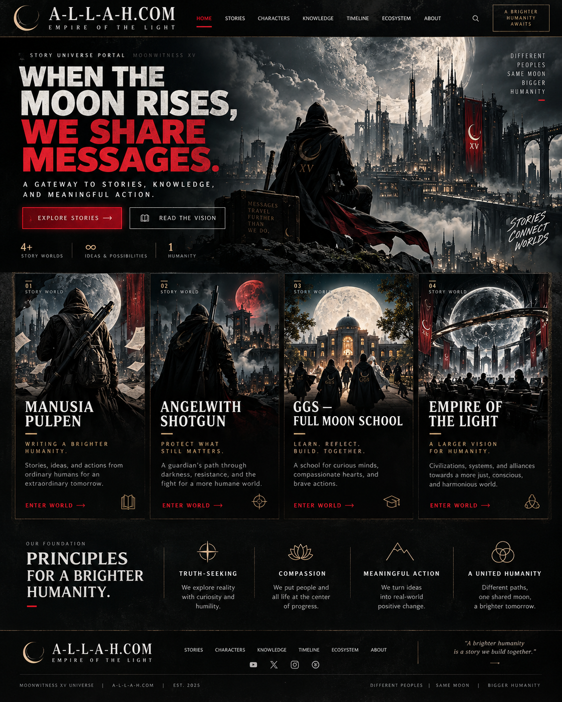
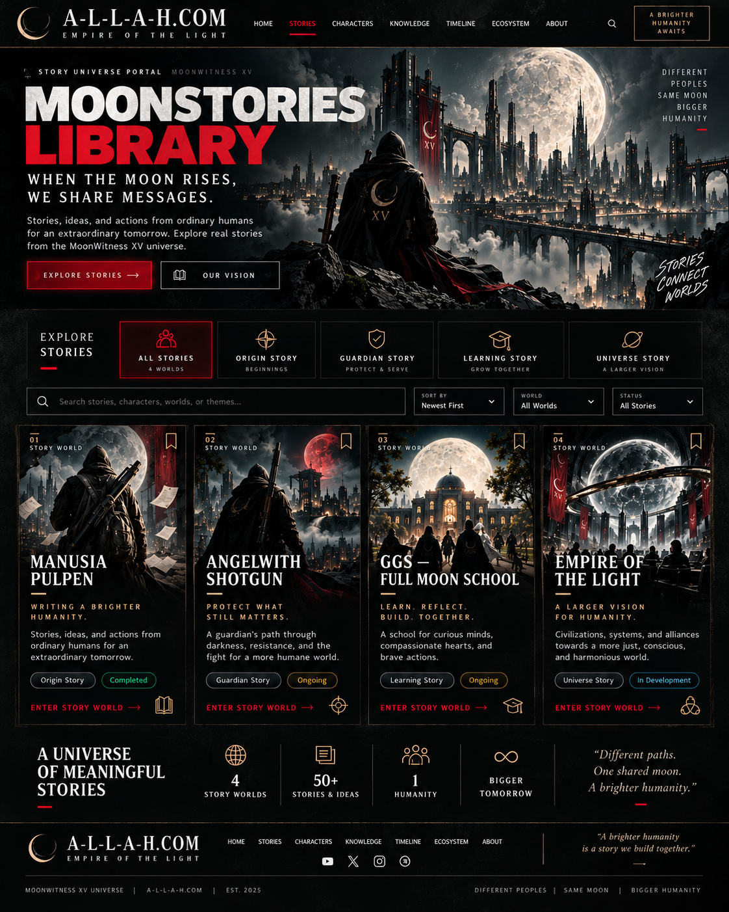
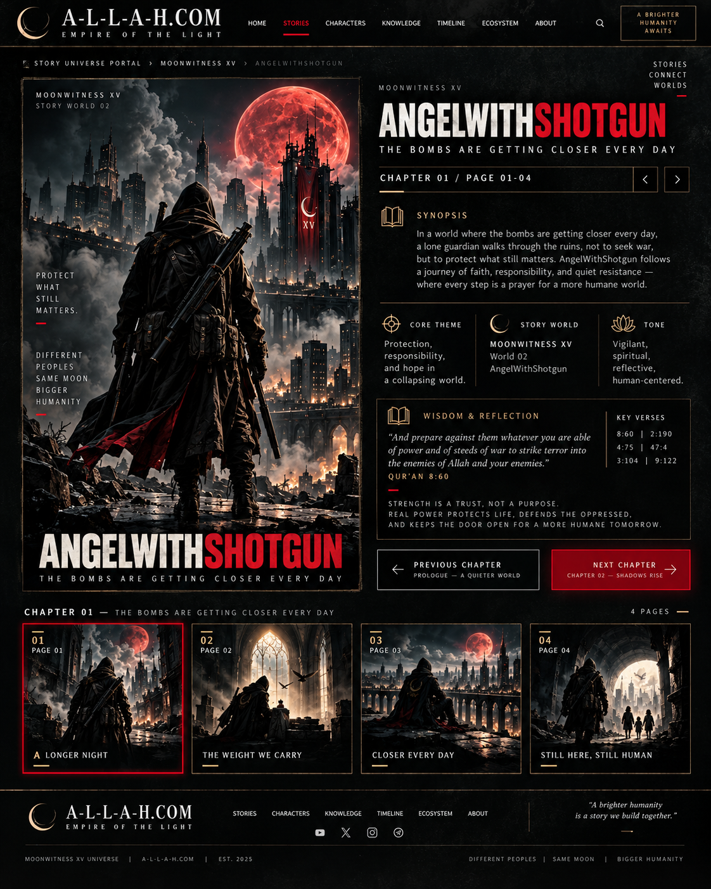
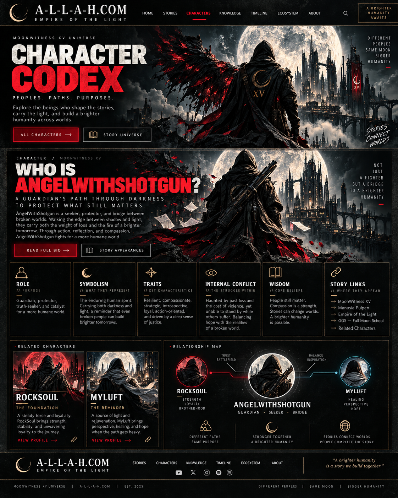
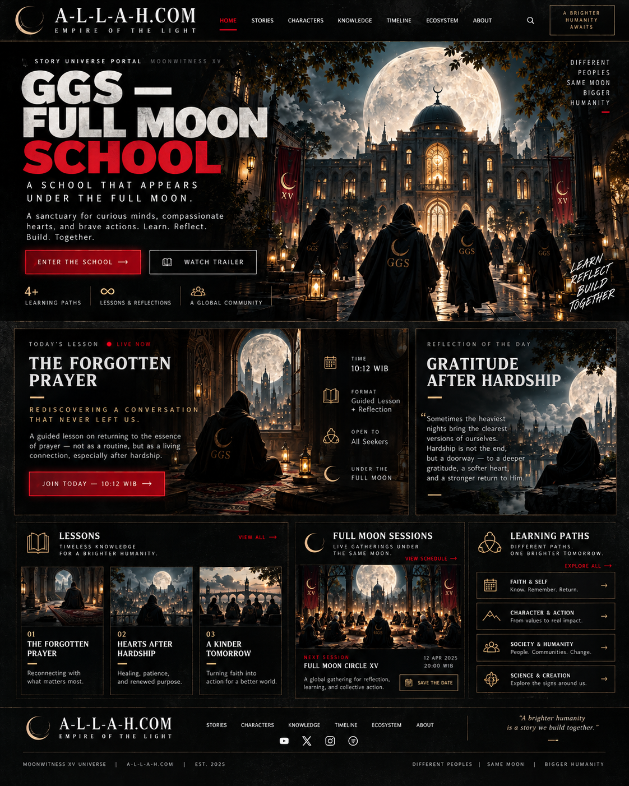

# A-L-L-A-H.COM / MOONWITNESS XV
# STORY UNIVERSE — VISUAL BIBLE + UI/UX + NARRATIVE + COMPONENT CONTRACT

> **Status:** DRAFT VISUAL-REFERENCE SPECIFICATION v1.0 · 29 Oktober 2026 (WIB)  
> **Hosting update (31 Oktober 2026):** the owner withdrew the isolated Vercel authorization and removed its project; Coolify remains the current Empire hosting path. Do not recreate a Vercel deployment without a new explicit decision. See ADR-0012 and ADR-0016.
> **Target reader:** AI coding lokal, engineer frontend, desainer, copywriter, reviewer UX, QA.  
> **Input wajib:** 5 PNG referensi di folder `assets/` (identik dengan mockup original yang dipilih user).  
> **Tujuan:** menerjemahkan **lima gambar mockup** menjadi website yang terasa **semirip mungkin**—struktur, komposisi, menu, ikon, tone, visual, konten, narasi dan perilaku, namun **tidak mengklaim pixel-perfect** bila mockup AI memiliki glyph, angka atau elemen yang tidak konsisten.  
> **Repository:** `https://github.com/bjo163/moonwitnessxv` · baseline integrasi: branch `dev` · aplikasi pilot: `apps/empire-web`.  
> **Sumber keputusan otoritatif:** accepted ADR > runtime code > BLUEPRINT.md > TODO.md > narasi canon > spesifikasi usulan ini.  
> **Aturan change-management:** jangan membuat branch baru tanpa instruksi, jangan menganggap semua aplikasi sudah live, jangan mengubah DNS atau deploy production, jangan menyalin data privat.  
> **Keputusan penting:** accepted ADR-0012 hanya mengizinkan **pilot statis lokal/CI** `empire-web` dan menetapkan Dock sebagai **canonical LIGHTHOUSE** berdasarkan ADR-0011. Dokumen ini adalah spesifikasi *calon penambahan fitur*, **bukan** izin menerbitkan konten publik atau mengganti kepemilikan arsitektur.

---

## 0. CARA MENGGUNAKAN DOKUMEN INI (WAJIB DIBACA AI LOKAL)

1. **Buka lima PNG** bersamaan dengan dokumen. Deskripsi teks **tidak menggantikan gambar**; PNG menjadi rujukan komposisi, imagery, tonal contrast, hierarki visual dan proporsi.
2. **Jangan generate lima dashboard yang serupa.** Halaman memiliki fungsi berbeda: (01) portal home, (02) story catalog, (03) story detail + comic reader, (04) character profile/codex, (05) GGS school/lessons.
3. Bedakan tiga level: `[VISUAL REFERENCE]` = perlu semirip screenshot; `[CANONICAL COPY]` = teks yang boleh dipakai setelah review; `[ILLUSTRATIVE ONLY]` = data mockup yang **bukan** fakta/fitur/tautan aktif.
4. Kerjakan dalam **existing `apps/empire-web`**, setelah audit perubahan terbaru; reuse MoonUI tokens, icon components, layout patterns. **Jangan mengkloning database, auth, Corpus, SHADOW, atau ARSY**.
5. Saat dokumen ini disusun pada 29 Oktober, site belum live di Vercel menurut pemeriksaan yang tersedia saat itu. Proyek Vercel sempat dibuat kemudian dan dihapus atas permintaan pemilik pada 31 Oktober; jangan membuat deployment baru tanpa keputusan eksplisit. Konten lokal tetap memakai data terkontrol dan gate hak publikasi.
6. Gambar `assets/*.png` adalah **screenshot referensi tata letak**. Jangan memakai PNG satu halaman sebagai **background entire site** sehingga teks/tombol tidak selectable, tidak accessible, dan tidak responsif.
7. **Narasi fiksi vs keyakinan:** ROCKSOUL, MYLUFT, GGS, AngelWithShotgun adalah karakter atau konstruksi naratif MoonWitness. Tidak mengklaim tokoh ini Nabi, Isa literal, malaikat sungguhan, penafsir yang berotoritas, atau memiliki amanat ilahi khusus.
8. **Hak sumber/teks suci:** teks Arab, transliterasi, terjemahan Al-Qur’an dan tafsir mesti bersumber jelas, diverifikasi, diberi konteks. Render sebagai teks semantik asli dengan `dir="rtl"`, bukan mengandalkan huruf hasil image generation. Jangan mengutip lirik lagu berhak cipta melebihi izin yang dimiliki.
9. **No face rule:** ROCKSOUL/AngelWithShotgun selalu dari belakang, 3/4 belakang, atau siluet tanpa wajah jelas. MYLUFT tidak diperlakukan sebagai figur ilahi. Hindari penggambaran Nabi/Allah.
10. **Artwork readiness:** mockup = visual referensi, **belum otomatis merupakan aset produksi**. Pisahkan `reference/*` dan `approved/*`; cek lisensi, ejaan gambar, karakter/identitas, dan keputusan rilis sebelum mengunggah banner.

### 0.1 Referensi gambar asli — 5 berkas (semuanya 1122 × 1402 px)

| ID | Berkas dalam paket | Nama halaman | Fokus visual |
|---|---|---|---|
| `REF-01` | `assets/01-homepage.png` | Empire of the Light — HOME | Full moon, ROCKSOUL di atas kota, hero + empat story-world |
| `REF-02` | `assets/02-moonstories-library.png` | MOONSTORIES LIBRARY | Hero, kategori filter, search, katalog empat kartu |
| `REF-03` | `assets/03-story-detail-reader.png` | AngelWithShotgun — Reader | Cover besar di kiri; synopsis/metadata/chapter di kanan; 4 thumbnail |
| `REF-04` | `assets/04-character-codex.png` | Character Codex | Hero guardian + profil unggulan, enam attributes, relationship graph |
| `REF-05` | `assets/05-ggs-full-moon-school.png` | GGS Full Moon School | Akademi purnama, lesson, reflection, session, learning paths |

**Pemetaan lokal awal:** lima file asli datang dari `moonlit_empire_of_light_homepage.png`, `moonstories_library_a_moonlit_universe.png`, `moonlit_guardian_empire_of_light.png`, `moonwitness_xv_character_codex.png`, `moon_academy_under_the_full_moon.png`.

### 0.2 Prinsip kesetiaan visual

- **P0, HARUS IDENTIK secara niat:** nama brand, struktur page, urutan seksi, posisi relatif kiri/kanan, layout empat kartu, tema warna black/gold/red, ikon semantik, judul, navigasi, penggunaan bulan besar, karakter tanpa wajah, chrome website dan footer.
- **P1, SANGAT MIRIP:** ukuran huruf relatif, rasio gambar, border tipis emas, panel foto bertingkat, hover, grain, overlay gradient, whitespace, label kecil uppercase dengan tracking, aksen merah pada title/active state.
- **P2, ADAPTIF:** detail kota fantasi, pencahayaan bulan, partikel kabut, torn-paper/grunge, tekstur, dekorasi glyph; boleh diganti aset asli **asalkan komposisi dan mood sama**.
- **DILARANG:** teks “random lorem ipsum”, referensi palsu, menu kosong yang terlihat aktif, button inert, klaim LIVE/Completed tanpa bukti, gambar semua kartu sama, gambar Nabi/Allah, wajah ROCKSOUL tampak.

---

## 1. BRAND SYSTEM — IDENTITAS A-L-L-A-H.COM

### 1.1 Nama, hirarki, tagline

- **Site / umbrella:** `A-L-L-A-H.COM` (menggunakan tanda hubung persis, bukan `ALLAH.COM`); nama teknologi/akronim **Accountable Life, Learning & Action Hub**.
- **Brand descriptor, uppercase tracked:** `EMPIRE OF THE LIGHT`.
- **Universe:** `MOONWITNESS XV`.
- **Editorial sub-universe:** `MOONSTORIES` / `STORY UNIVERSE PORTAL`.
- **Motto situs, hero:** `WHEN THE MOON RISES, WE SHARE MESSAGES.`
- **Secara narasi:** `Different peoples. Same moon. Bigger humanity.`
- **Footer:** `A brighter humanity is a story we build together.`
- **Kanon spiritual personal:** `Only You. Your Deeds. And ALLAH.` (jangan campur sebagai kebijakan situs atau klaim ilahi).
- **Manusia Pulpen:** origin ROCKSOUL, dimulai Rabu 28 Oktober 2026 dan ditulis Kamis 29 Oktober 2026 sesuai canon.
- **AngelWithShotgun:** guardian alter-ego naratif ROCKSOUL; tanpa wajah; *The Bombs Are Getting Closer Every Day* adalah judul sub-story dan inspirasi rasa cemas, **bukan** ajakan kekerasan.
- **GGS:** sekolah **fiksi** dari narasi MYLUFT, hanya tampak saat bulan purnama **dalam cerita**, bukan institusi nyata atau acara publik otomatis.

### 1.2 Palet dark editorial — screenshot-inspired **approximation**

| Token | Nilai awal | Pemakaian |
|---|---|---|
| `--eol-bg-canvas` | `#090B0D` | page background hitam hampir pekat |
| `--eol-bg-surface` | `#131518` | card/panel gelap |
| `--eol-bg-elevated` | `#1C1E22` | cards saat elevated/hover |
| `--eol-ink-primary` | `#F1EDE5` | judul putih gading |
| `--eol-ink-secondary` | `#C1C0BC` | deskripsi |
| `--eol-ink-muted` | `#92938F` | eyebrow, stats, labels |
| `--eol-line` | `#514638` | garis/border emas redup |
| `--eol-gold` | `#C5A578` | ikon, subheading, aksen; bukan latar seluruh panel |
| `--eol-gold-bright` | `#E3C391` | CTA dan focus emas |
| `--eol-red` | `#DB1E31` | judul kedua, active tab, primary CTA |
| `--eol-red-hover` | `#F03245` | primary hover |
| `--eol-moonlight` | `#D6D5CD` | bright full moon |
| `--eol-blue-shadow` | `#4A596B` | lunar haze / shadow cool |
| `--eol-success` | `#4FBE87` | status terverifikasi selesai |
| `--eol-warning` | `#DAA544` | WIP secara faktual |
| `--eol-info` | `#59B7CF` | planned/development |

**Catatan:** angka di atas **bukan sampling pixel-perfect final**—gambar generated bukan file Figma/tokens; gunakan CSS tokens terpusat dan lakukan side-by-side tuning terhadap PNG.

### 1.3 Tipografi (kontrak visual, bukan klaim font exact screenshot)

- Brand `A-L-L-A-H.COM`: **serif elegan** uppercase, tracking lebar, bentuk geometris klasik. Calon `Cinzel`/`Cormorant Garamond` hanya bila cocok lisensi, performa dan token MoonUI; fallback `Georgia, serif`.
- Headline HERO: **ultra-bold condensed sans** (nuansa `Anton` / `Archivo Black` / `Impact`), white/red split, `font-weight: 900`, line-height `0.92–1.04`, tracking `-0.02em–-0.055em`. Jangan memilih typeface grotesk biasa yang terlalu tipis.
- Secondary heading (GGS, synopsis, literature): serif editorial moderately bold.
- Nav dan eyebrow: clean condensed sans uppercase, letter spacing `0.16–0.30em`, 10–13 px desktop.
- Body: readable humanist sans ~14–17 px, line-height 1.5–1.7, bukan semua-uppercase.
- Small editorial footer: 9–11px **hanya untuk dekoratif**; informasi penting tidak boleh sekecil itu di mobile.
- Angka/badge/metadata: tabular numerals agar `01`, `02`, `03`, `04` tampak stabil.
- Arabic (jika bagian cerita sudah approved): font Arab berkualitas dan text RTL terpisah; jangan menulis `text-transform` atau letter-spacing CSS untuk aksara Arab.

### 1.4 Grid dan layout

- Pada desktop, target `max-width: 1440px` atau `1600px`, centered container; screenshot 1122px lebar adalah **mockup editorial kompresi**, bukan ukuran browser yang wajib diikuti absolut.
- Header tinggi desain ~68–86px desktop, border-bottom tipis warm gold.
- Page padding desktop `clamp(24px,4vw,64px)`; header footer sejajar dengan content grid.
- Main content: 12-column grid, gap 12–24px, margin berlapis. Story card grid **4 kolom** desktop; library beralih 2 tablet, 1 mobile.
- Poster/cover dalam katalog aspect ratio **3:4** sampai **4:5**, object-position tuned ke subjek utama.
- Cover pada detail reader: vertikal tinggi (sekitar 1:1.45), backdrop banded fade; jangan crop judul/poster penting.
- Section layout selang-seling: atmospheric hero → solid dark cards → editorial manifesto → footer.
- Grid dan garis panel **tegas, square/2px radius**; bukan rounded SaaS dashboard.

### 1.5 Tekstur dan visual DNA

- Full moon atau purnama raksasa selalu menjadi jangkar visual, di atas kota metropolis gothic-neo-futurist, awan, kabut, menara, jembatan, banner XV.
- Palet hampir monochrome (hitam/putih), highlight **deep scarlet**, emas antik, sentuhan moonlight silver; tidak pakai gradasi ungu-kuning pastel generik.
- Dystopian-but-hopeful. Kerusakan kota bisa menjadi konteks karakter, **bukan** glorifikasi serangan atau kebencian terhadap kelompok.
- ROCKSOUL memakai hoodie/cape hitam-merah, tas kecil logo mahkota; **selalu back view**.
- Overlays: 2–3 tingkat linear gradient (black fade untuk teks), grain rendah, vignette, light bloom lokal pada bulan, bukan background blur seluruh teks.
- Gunakan efek film grain/CSS radial glow dan overlay secara ringan; audit `prefers-reduced-motion` dan performa LCP.
- Ornamen: bulan sabit outline emas, garis emas halus, garis bawah merah 2px, potongan kertas, logo crown/XV, typed status dan editorial numbers.

### 1.6 Elemen global (setiap mockup)

**Header:**

```text
[◯ CRESCENT] A-L-L-A-H.COM     HOME  STORIES  CHARACTERS  KNOWLEDGE  TIMELINE  ECOSYSTEM  ABOUT    [SEARCH]   [A BRIGHTER HUMANITY AWAITS]
             EMPIRE OF THE LIGHT
```

- Logo left; nav tengah; search right; CTA outline emas di ujung kanan.
- **Active navigation:** text merah + underline pendek merah tepat di bawah menu aktif.
- Jika route merupakan GGS/Reader, menu aktif mengikuti hirarki: `STORIES` untuk detail dan GGS story, `CHARACTERS` untuk Codex.
- Search icon `Search`, berupa tombol nyata; untuk MVP bisa membuka local search dialog berbasis **approved manifest**. Bila fitur belum dibuat, jangan render tombol pencarian aktif yang inert.
- Right CTA `A BRIGHTER HUMANITY AWAITS` taut ke section `values/mission` yang sudah ada, bukan external CTA palsu.
- Mobile: logo + search + hamburger, accessible sheet/drawer, semua menu hadir; close via Escape dan focus restore.

**Footer:**

```text
[◯] A-L-L-A-H.COM      HOME  STORIES  CHARACTERS  KNOWLEDGE  TIMELINE  ECOSYSTEM  ABOUT     “A brighter humanity is a story we build together.”
    EMPIRE OF THE LIGHT
                                   [youtube?] [X?] [instagram?] [other?]
MOONWITNESS XV UNIVERSE  |  A-L-L-A-H.COM  |  EST. 2026          DIFFERENT PEOPLES  |  SAME MOON  |  BIGGER HUMANITY
```

- Sosial ikon di mockup **illustrative**. Hanya tautkan jika URL resmi benar-benar tersedia/diapprove; jika tidak, sembunyikan alih-alih menebak.
- Screenshot beberapa kali mencetak `EST. 2025`; **bukan fakta canon**. Normalisasi `EST. 2026` atau hilangkan `EST.` sampai tanggal resmi brand diputuskan. **Jangan memalsukan sejarah.**
- Footer divider emas 1px, struktur kiri/kanan tetap stabil.

### 1.7 Ikon: mapping visual → komponen semantik

Gunakan ikon resmi di `@moonwitness/moonui/icons` **jika tersedia**; audit export yang benar terlebih dahulu. Bila tidak tersedia, icon package yang sudah ada di repo atau **SVG inline** orisinal dengan stroke konsisten `1.5–2px` (jangan hardcode paket baru tanpa review). Semua dekoratif `aria-hidden`.

| Konsep | Peta nama ikon (referensi) | Pemakaian mockup |
|---|---|---|
| Crescent | `moon` / bespoke `crescent-gold` | logo, World ID, full moon session |
| Search | `search` | header dan search library |
| Home | `home` bila perlu | breadcrumb/mobile |
| Stories | `book-open`, `library` | Story Library, synopsis, prev chapter |
| All stories/people | `users-round`, `users` | filter all stories, humanity stats |
| Origin | `compass`, `crosshair` | origin story filter |
| Guardian | `shield` / `shield-check` | guardian filter, protective theme |
| School / Learning | `graduation-cap` | GGS tab, learning story |
| Universe | `orbit`, `globe-2` | universe filter, stats |
| Bookmark | `bookmark` | story card save state (only when implemented) |
| Previous/next | `arrow-left`, `arrow-right`, `chevron-left/right` | chapter/page navigation |
| Down/select | `chevron-down` | filter dropdown |
| Truth | `crosshair` / target-ring emblem | principle Truth-seeking |
| Compassion | `flower-2`/lotus SVG | foundation card |
| Action | `mountain`, `mountain-snow` | meaningful action |
| Unity | `venn` / 3 interlocking circles SVG | united humanity |
| User | `user-round` | Role attribute |
| Symbolism | `moon` | Character Codex symbolism |
| Traits | `sparkles` / `star` | Codex trait card |
| Conflict | `eye` | Codex internal conflict |
| Wisdom | `book-open` | Codex wisdom |
| Connections | `link` | story links / profile |
| Relation graph | nodes + SVG connectors | ROCKSOUL ⇄ AngelWithShotgun ⇄ MYLUFT |
| Clock / schedule | `calendar-days`, `clock-3` | GGS lesson metadata (fictional clock) |
| Community | `users-round` | GGS society path |
| Faith/Self | `calendar-days`/crescent custom | GGS Faith & Self |
| Character & Action | `mountain` | GGS path |
| Science & Creation | `atom` | GGS path |
| Crown XV | original SVG/crown line glyph | backpack/brand motifs, no literal throne implication |
| External link | `arrow-up-right` | only validated external URLs |

**Icon system rules:** size 16/20/24/32, stroke gold, no random emoji-as-icon, same stroke/same optical weight, labels visible for accessibility, status color not conveyed solely by hue.

---

## 2. GLOBAL INFORMATION ARCHITECTURE (ROUTES + MENU)

### 2.1 Screenshot menu — exact order

1. `HOME`
2. `STORIES`
3. `CHARACTERS`
4. `KNOWLEDGE`
5. `TIMELINE`
6. `ECOSYSTEM`
7. `ABOUT`
8. `[SEARCH]` (icon button)
9. `[A BRIGHTER HUMANITY AWAITS]` (small gold outline CTA)

### 2.2 Route contract — proposed, **not evidence route already exists**

| Menu/page | Proposed URL (ID) | EN | Target/phase |
|---|---|---|---|
| HOME | `/id` | `/en` | Keep current pages; **enhance**, don't replace canon silently |
| STORIES | `/id/stories` | `/en/stories` | New public-safe catalog after editorial approval |
| Story detail | `/id/stories/angelwithshotgun` | `/en/stories/angelwithshotgun` | Narrative + chapters; no fake backlinks |
| Comic chapter | `/id/stories/angelwithshotgun/chapter-01` | EN analog | Poster viewer, pages 01–04 |
| OTHER stories | `/id/stories/manusia-pulpen`, `/id/stories/ggs-full-moon-school` | EN analog | Use approved story manifest |
| CHARACTERS | `/id/characters` | `/en/characters` | Character Codex |
| Character detail | `/id/characters/angelwithshotgun` | EN analog | Profile & related stories |
| KNOWLEDGE | `/id/knowledge` | `/en/knowledge` | Safe overview, *not* a new Corpus DB |
| TIMELINE | `/id/timeline` | `/en/timeline` | Curated timeline; do not imply fully implemented history |
| ECOSYSTEM | `/id/ecosystem` | `/en/ecosystem` | Already exists in pilot; preserve contract |
| ABOUT | `/id/about` | `/en/about` | Already exists in pilot; preserve contract |
| GGS | `/id/ggs` | `/en/ggs` | Full Moon School narrative hub |
| GGS lesson | `/id/ggs/the-forgotten-prayer` | EN analog | QS Yunus 10:12 with reviewed source |
| VALUES | `/id/values` | `/en/values` | Existing; footer/header CTA fallback |
| SOURCES / PRIVACY | `/id/sources`, `/id/privacy` | EN analog | Keep existing, expand citations/rights |

**Rules:** preserve existing locale routing / root fallback from `apps/empire-web`. `hrefLang`, document `lang`, canonical metadata and exact pathname in locale switch; internal paths only to routes that actually exist, no broken navigation. Dock remains canonical LIGHTHOUSE until accepted architectural decision says otherwise.

---

## 3. PAGE 01 — HOME / EMPIRE OF THE LIGHT (`REF-01`)



### 3.1 Page role / visual overview

**Goal:** first impression of a cohesive Story Universe; high-impact cinematic hero with moonlit gothic megacity, ROCKSOUL **back view seated on rooftop ridge** in the foreground. Composition screenshot: header at top (~5% screenshot height); massive hero (~33%); four vertical story cards (~35%); values row (~14%); editorial footer bottom.

Hero left ~45% contains bold multi-line title, intro, CTAs and compact stats; hero right ~55% is illustration with full moon and the red XV banner. Do **not** put UI cards floating over moon face or cover the main character.

### 3.2 Copy — screenshot fidelity

- Header same as §1.6, active `HOME`.
- Small left hero eyebrow: `STORY UNIVERSE PORTAL   MOONWITNESS XV`.
- **Hero H1 in four lines**:

```text
WHEN THE
MOON RISES,
WE SHARE
MESSAGES.
```

  Top two lines cream/white; `WE SHARE` and `MESSAGES.` **red**.

- Subtitle: `A GATEWAY TO STORIES, KNOWLEDGE, AND MEANINGFUL ACTION.`
- CTAs: `[ EXPLORE STORIES → ]` red filled, `[ ▣ READ THE VISION ]` charcoal outlined.
- Small right vertical decorative script: `DIFFERENT PEOPLES / SAME MOON / BIGGER HUMANITY`.
- Right brush script over city: `STORIES CONNECT WORLDS`.
- Stats: `4+  STORY WORLDS` · `∞  IDEAS & POSSIBILITIES` · `1  HUMANITY`. **`4+` is visual/sample; verify manifest count before showing number.**

### 3.3 Four story-world cards (desktop 4 across)

#### Card 01 — MANUSIA PULPEN

- Image: hooded ROCKSOUL facing away, muted golden moon, scattered manuscript pages, dark city stairs.
- ID: `01 / STORY WORLD` top edge.
- Title: `MANUSIA` line 1 / `PULPEN` line 2.
- Gold thematic microcopy: `WRITING A BRIGHTER HUMANITY.`
- Body: `Stories, ideas, and actions from ordinary humans for an extraordinary tomorrow.`
- Bottom CTA: `ENTER WORLD →` red text, book icon gold at far right.
- Click destination: story route once actually available, otherwise visible under-design metadata with no fake click.

#### Card 02 — ANGELWITHSHOTGUN

- Image: red moon + ROCKSOUL back silhouette, rose-black palette, long black cloak; **no face**.
- ID: `02 / STORY WORLD`.
- Title line-break `ANGELWITH` / `SHOTGUN`.
- Gold thematic microcopy: `PROTECT WHAT STILL MATTERS.`
- Body: `A guardian’s path through darkness, resistance, and the fight for a more humane world.`
- CTA: `ENTER WORLD →`; guardian/compass/crosshair visual emblem gold.
- **Narrative boundary:** no endorsement of real-world violence; guardian protects, reflects and remains accountable.

#### Card 03 — GGS FULL MOON SCHOOL

- Image: glowing full moon over warm lantern-lit academy courtyard; faceless cloaked learners from behind.
- ID: `03 / STORY WORLD`.
- Title `GGS` / `FULL MOON SCHOOL`.
- Thematic microcopy: `LEARN. REFLECT. BUILD. TOGETHER.`
- Body: `A school for curious minds, compassionate hearts, and brave actions.`
- CTA: `ENTER WORLD →`; academic-cap icon gold.
- **Narrative-only school**, not actual university/program/event.

#### Card 04 — EMPIRE OF THE LIGHT

- Image: giant moon/orbit ring and city center around roundtable, realm seen from above, gold/silver lights.
- ID: `04 / STORY WORLD`.
- Title `EMPIRE OF` / `THE LIGHT`.
- Microcopy: `A LARGER VISION FOR HUMANITY.`
- Body: `Civilizations, systems, and alliances towards a more just, conscious, and harmonious world.`
- CTA: `ENTER WORLD →`; 3 interconnected circles icon gold.
- **Note:** aspirational universe concept, not claim about active alliances/institutions.

### 3.4 Principles row (horizontal)

Header first cell (wider):

```text
OUR FOUNDATION
PRINCIPLES
FOR A BRIGHTER
HUMANITY.
```

Other 4 mini-columns with gold line icons:

1. **TRUTH-SEEKING** — target / compass icon — `We explore reality with curiosity and humility.`
2. **COMPASSION** — lotus/flower line icon — `We put people and all life at the center of progress.`
3. **MEANINGFUL ACTION** — mountain/peak icon — `We turn ideas into real-world positive change.`
4. **A UNITED HUMANITY** — three overlapping circles icon — `Different paths, one shared moon, a brighter tomorrow.`

### 3.5 Interaction & responsiveness

- Red primary goes to `stories` only if page exists; white outlined to `values/about` already available.
- Story cards entire click target, focus ring visible; decorative `ENTER WORLD` is child label, avoid nested `<a>`.
- At `>=1200`: four cards. `768–1199`: 2×2. `<768`: stacked 1×4 or horizontal carousel with **fully keyboard-accessible** navigation; prioritize simple stacked.
- On mobile hero title 40–58px, with last two lines red, image below copy or behind with gradient overlay; moon never cropped too far.
- Quote and data labels should not be baked into cover image; HTML copy visible and selectable.

### 3.6 Screenshot-to-code acceptance

- [ ] Top nav exactly ordered, active HOME red underline.
- [ ] Giant moon and ROCKSOUL seated back view to the right of hero.
- [ ] H1 text and red two-line highlight correct.
- [ ] Two functional CTA with contrasting filled/outlined styling.
- [ ] Four clearly different story cards, each image unique and thematic.
- [ ] Four values with semantically matching icons; gold lines.
- [ ] Responsive/mobile, keyboard, alt text, locale and footer parity.

---

## 4. PAGE 02 — MOONSTORIES LIBRARY (`REF-02`)



### 4.1 Distinct layout

Same full-width header, **STORIES active in red**. Main upper hero shows same ruined futuristic lunar skyline but a **standing/sitting hooded guardian at mid-right**; H1 left, 2 lines white/red. Below it category tiles, below search/sort controls, then 4-card catalog, stats row, footer.

### 4.2 Hero copy

- Eyebrow: `STORY UNIVERSE PORTAL   MOONWITNESS XV`.
- H1 `MOONSTORIES` in bold WHITE; `LIBRARY` second line in bright RED.
- Large literary secondary: `WHEN THE MOON RISES, WE SHARE MESSAGES.`
- Body: `Stories, ideas, and actions from ordinary humans for an extraordinary tomorrow. Explore real stories from the MoonWitness XV universe.`
- Primary CTA: `EXPLORE STORIES →`; secondary: `OUR VISION`.
- Right stacked: `DIFFERENT PEOPLES / SAME MOON / BIGGER HUMANITY`.
- Brush script across skyline: `STORIES CONNECT WORLDS`.

### 4.3 Category tabs — exact order and icons

| Tab visible label | Small sublabel | Icon | UI meaning |
|---|---|---|---|
| `ALL STORIES` | `4 WORLDS` | users 3 figures | all category, selected default |
| `ORIGIN STORY` | `BEGINNINGS` | compass/target | Manusia Pulpen |
| `GUARDIAN STORY` | `PROTECT & SERVE` | outlined shield | AngelWithShotgun |
| `LEARNING STORY` | `GROW TOGETHER` | graduation cap | GGS |
| `UNIVERSE STORY` | `A LARGER VISION` | orbit circle | Empire of the Light |

Selected tab screenshot: bold red thin stroke, reddish inner glow, active icon red and lighter text; others charcoal with thin gold-gray borders. Tabs must be `<button>` or link, reflect `aria-selected/aria-current` and work with keyboard.

### 4.4 Control bar

Layout screenshot:

```text
[ 🔍 Search stories, characters, worlds, or themes... ]  [SORT BY  Newest First ▾]  [WORLD  All Worlds ▾]  [STATUS  All Stories ▾]
```

- Search client-side, debounce small optional; no server / no collection tracking on static pilot.
- `SORT BY`: `Newest First`, `Oldest First`, `Title A–Z` (only if timeline metadata real); static sorted default defined in manifest.
- `WORLD`: `All Worlds` plus 4 story-world names from manifest.
- `STATUS`: `All Stories`, `Complete`, `Ongoing`, `Planned`; derive from **editorial publication state** not GitHub build status.
- Empty results must show useful message and reset filters; no fake spinner.

### 4.5 Four visible cards — exact hierarchy

Each card uses tall cover image, small index in upper-left, bookmark icon upper-right **only when implemented**, dark fade at bottom, large white serif title, gold caps tagline, small body, two metadata pills (genre/status), footer red `ENTER STORY WORLD →` and gold genre glyph.

1. `01 MANUSIA PULPEN` — `WRITING A BRIGHTER HUMANITY.` — same body as home; genre pill `Origin Story`; screenshot status `Completed` (ILLUSTRATIVE until verified).
2. `02 ANGELWITHSHOTGUN` — `PROTECT WHAT STILL MATTERS.` — guardian description; pill `Guardian Story`; screenshot status `Ongoing` (ILLUSTRATIVE).
3. `03 GGS FULL MOON SCHOOL` — `LEARN. REFLECT. BUILD. TOGETHER.` — academy body; pill `Learning Story`; screenshot status `Ongoing` (ILLUSTRATIVE).
4. `04 EMPIRE OF THE LIGHT` — `A LARGER VISION FOR HUMANITY.` — lore/universe body; pill `Universe Story`; screenshot status `In Development` (ILLUSTRATIVE).

**Source caveat:** `Completed`, `Ongoing` and `In Development` here are **mock status examples**, not evidence of public release. Do not render `Completed` until a specific manifest and published chapter count prove it. Archive/story canon status can differ from website publication status.

### 4.6 Bottom statistics row

- Heading: `A UNIVERSE OF MEANINGFUL STORIES`.
- `4 STORY WORLDS` (allowed only if manifest has 4).
- `50+ STORIES & IDEAS` (**unverified**, replace actual derived count or `STORIES & IDEAS` without number).
- `1 HUMANITY` as editorial poetry, not measured metric.
- `∞ BIGGER TOMORROW` symbolic, not business metric.
- Right handwritten gold quote: `Different paths. One shared moon. A brighter humanity.`

### 4.7 Mobile/behavior acceptance

- Filters horizontally scrollable with visible partial next tile or stacked buttons; `aria-label` and clear selected state.
- Search spans full mobile width; dropdowns wrap 2 columns or stack.
- Cards stack; avoid tiny unreadable 4-across on mobile.
- Search/filter operate against **one canonical `storyManifest`**, not independently hardcoded cards.
- URL filters encoded into `searchParams` if feasible; static export needs client-only update without server dynamic queries.
- Different story cards must use **different asset**: never repeat same hero for all categories.

---
## 5. PAGE 03 — ANGELWITHSHOTGUN STORY DETAIL + COMIC READER (`REF-03`)



### 5.1 Page role dan komposisi

**Goal:** memberi konteks dan membuka 4 halaman komik, bukan generic character bio. Layout desktop **dua kolom tidak sama besar**; kiri cover besar portrait (~52%), kanan panel literatur (~48%). Header aktif `STORIES` merah, lalu breadcrumb, kemudian detail, thumbnail empat halaman, footer.

Contoh kerangka screenshot:

```text
STORY UNIVERSE PORTAL > MOONWITNESS XV > ANGELWITHSHOTGUN

┌─────────────────────────────────────────────┬────────────────────────────────────────────────┐
│                                             │  MOONWITNESS XV                               │
│                                             │  ANGELWITH[white]SHOTGUN[red]                │
│        LARGE CINEMATIC COVER ART            │  THE BOMBS ARE GETTING CLOSER EVERY DAY      │
│     back-view hooded guardian, red moon     │  CHAPTER 01 / PAGE 01–04      [‹] [›]        │
│                                             │  SYNOPSIS  (book icon)                        │
│                                             │  summary paragraph                           │
│                                             │  [CORE THEME] [STORY WORLD] [TONE]           │
│                                             │  WISDOM & REFLECTION                         │
│                                             │  KEY VERSES / SOURCE REVIEW                  │
│                                             │  [← PREVIOUS CHAPTER] [NEXT CHAPTER →]       │
└─────────────────────────────────────────────┴────────────────────────────────────────────────┘

CHAPTER 01 — THE BOMBS ARE GETTING CLOSER EVERY DAY                            4 PAGES
[01 A LONGER NIGHT] [02 THE WEIGHT WE CARRY] [03 CLOSER EVERY DAY] [04 STILL HERE, STILL HUMAN]
```

### 5.2 Screenshot literal content (subject to editorial verification)

- Breadcrumb: `STORY UNIVERSE PORTAL  >  MOONWITNESS XV  >  ANGELWITHSHOTGUN`.
- Eyebrow right: `MOONWITNESS XV`.
- Display heading: `ANGELWITHSHOTGUN`, with `ANGELWITH` white, `SHOTGUN` RED.
- Subheading tracked: `THE BOMBS ARE GETTING CLOSER EVERY DAY`.
- Counter: `CHAPTER 01 / PAGE 01–04` + two bordered arrow squares `[‹]` `[›]`.
- Left artwork small top: `MOONWITNESS XV / STORY WORLD 02`; left ink sticker: `PROTECT WHAT STILL MATTERS.`; left bottom big story title.

#### Synopsis block

> In a world where the bombs are getting closer every day, a lone guardian walks through the ruins, not to seek war, but to protect what still matters. AngelWithShotgun follows a journey of faith, responsibility, and quiet resistance—where every step is a prayer for a more humane world.

**Metadata 3 columns separated by golden vertical borders:**

| Label | Mock text |
|---|---|
| `CORE THEME` | `Protection, responsibility, and hope in a collapsing world.` |
| `STORY WORLD` | `MOONWITNESS XV — World 02 — AngelWithShotgun` |
| `TONE` | `Vigilant, spiritual, reflective, human-centered.` |

#### Wisdom & Reflection card

- Black outlined gold panel; gold book icon + heading `WISDOM & REFLECTION`.
- Gold rule and dark divider; main reflection (safe editorial formulation): `Strength is a trust, not a trophy. Real power protects life, defends those at risk, and keeps the door open for a more humane tomorrow.`
- Screenshot shows a quotation attributed to **Qur'an 8:60**, and a list called `KEY VERSES` (`8:60`, `2:190`, `4:75`, `47:4`, `3:104`, `9:122`). **Do not copy a verse snippet or interpretive claim blindly from the generated image.** The exact verse list is illustrative design data, requires independent primary-source checks, historical/exegetical context, publication rights, and human editorial signoff. For static pilot, render a reviewed neutral `Sources & Context` box or omit unsupported attribution.

#### Chapters/buttons

- Mock button left `← PREVIOUS CHAPTER` with subtitle `PROLOGUE — A QUIETER WORLD`.
- Mock button right `NEXT CHAPTER →` with subtitle `CHAPTER 02 — SHADOWS RISE`.
- **These labels are story-design proposals only.** Do not invent unpublished chapters or active links. If current story has only 4 poster pages, use next/previous **PAGE** within Chapter 01 instead, with disabled state at boundaries.

### 5.3 Comic reader / thumbnail strip

Four same-width cards across desktop, each with unique visual and number at top left, selected 01 stroke crimson glow, others thin gold. Each card's bottom vignette carries a readable caption:

| Page | Screenshot caption | Story focus / suggested canonical text |
|---|---|---|
| `01` | `A LONGER NIGHT` | Dunia terasa makin dekat dengan ancaman; ROCKSOUL tetap manusia dan berdoa |
| `02` | `THE WEIGHT WE CARRY` | Beratnya tanggung jawab, keberanian tanpa membenci |
| `03` | `CLOSER EVERY DAY` | Refleksi mendekati kesulitan, menjaga iman dan kemanusiaan |
| `04` | `STILL HERE, STILL HUMAN` | Penutup yang mengutamakan pertolongan, doa dan harapan |

**Actual content manifest:** use approved 4-poster sequence; do not assume all comic images in prior generated conversation are valid or have been published/reviewed. Set `assetsApproved: false` until reviewed. PNG posters may have corrupted Arabic/typography and must be checked rather than directly served to public.

### 5.4 Reader interaction spec

- `selectedPage` is the single source of truth; click thumbnail updates large image, page title, alt text and counter.
- Prev/next arrow disabled visibly on first/last page; keyboard left/right only when reader focus and not inside form; optional swipe on touch only with accessible button alternative.
- Main image: `object-fit: contain`, `max-height` tuned to screen; zoom/fullscreen optional if real controls implemented. Do not stretch image horizontally or embed text as bitmap alone.
- Use readable text transcript and `source` accordion beneath image when poster has long content; screen reader access, user-selectable, zoom.
- Accessible selected state: `aria-current="page"` or appropriate tab semantics and explicit selected style; announce page changes to live region politely.
- History (optional): `?page=2` or segment route; avoid invalid hard links in static export.
- On mobile, cover above synopsis or reader viewport with thumbnails below horizontally scrollable; sticky bottom prev/next is optional; never make navigation inaccessible due to horizontal overflow.
- No autoplay sound, no automatic violent motion, avoid fake playback icons. `prefers-reduced-motion` respected.
- Prev/next chapter buttons only if `chapterManifest` has targets marked `published`. No disabled buttons styled as live.

### 5.5 Comic narrative/canon boundaries

- Character's visual DNA: ROCKSOUL with hoodie black/dark red, back view, moon silhouette, city at night. Wing-like aura may exist symbolically, **not** literal depiction of angels or divine appointment.
- AngelWithShotgun is **fictional** and draws on archetypes of courage, compassion, humility and spiritual self-reflection, not literal fusion of religious personalities.
- Recurring text: `Still here. Still human. Still praying.`
- `The Bombs Are Getting Closer Every Day` is the work's subtitle, not a statement about present threats, and not a call to attack others.
- Stories should depict empathy with displaced people and avoid dehumanization and graphic violence.

---

## 6. PAGE 04 — CHARACTER CODEX (`REF-04`)



### 6.1 Layout map

Active menu `CHARACTERS`. Hero across full width: left **CHARACTER / CODEX** giant split white/red; subline `PEOPLES. PATHS. PURPOSES.`; right back-facing guardian with dark black/red aura under huge moon and city. Under hero: featured character broad landscape panel, row 6 compact black attributes, lower 2-column `RELATED CHARACTERS` left and `RELATIONSHIP MAP` right, footer.

### 6.2 Hero copy

```text
MOONWITNESS XV UNIVERSE
CHARACTER        [WHITE]
CODEX            [RED]
PEOPLES. PATHS. PURPOSES.
```

Body: `Explore the beings who shape the stories, carry the light, and build a brighter humanity across worlds.`
Buttons: `[ ALL CHARACTERS → ]` red / `[ STORY UNIVERSE ]` outlined.
Right decoration: `DIFFERENT PEOPLES / SAME MOON / BIGGER HUMANITY`; brush script `STORIES CONNECT WORLDS`.

### 6.3 Featured: WHO IS ANGELWITHSHOTGUN?

Featured black panel with image of guardian from rear on right and summary on left:

- Eyebrow `CHARACTER / MOONWITNESS XV`.
- H2 `WHO IS` (white), `ANGELWITHSHOTGUN?` (red).
- Small uppercase: `A GUARDIAN’S PATH THROUGH DARKNESS, TO PROTECT WHAT STILL MATTERS.`
- Suggested copy transcribing screenshot intent: `AngelWithShotgun is a seeker, protector, and bridge between broken worlds. Walking the edge between shadow and light, they carry both the weight of loss and the fire of a brighter tomorrow. Through action, reflection, and compassion, AngelWithShotgun works for a more humane world.`
- CTAs `[ READ FULL BIO → ]` red; `[ STORY APPEARANCES ]` outline.
- Side annotation: `NOT JUST A FIGHTER / BUT A BRIDGE / TO A BRIGHTER HUMANITY`.

### 6.4 Six trait blocks — exact count, order and meanings

| # | Icon | Label | Sub-label | Canonical-safe content |
|---|---|---|---|---|
| 1 | person line | `ROLE` | `// PURPOSE` | `Guardian, protector, truth-seeker, and catalyst for a more humane world.` |
| 2 | crescent | `SYMBOLISM` | `// WHAT THEY REPRESENT` | `The enduring human spirit, carrying both darkness and light, reminded that even broken people can build brighter tomorrows.` |
| 3 | star/spark | `TRAITS` | `// KEY CHARACTERISTICS` | `Resilient, compassionate, strategic, introspective, loyal, action-oriented, and driven by justice.` |
| 4 | eye | `INTERNAL CONFLICT` | `// THE STRUGGLE WITHIN` | `Haunted by loss and the cost of violence, learning to stand by others while refusing to become what they fear.` |
| 5 | book | `WISDOM` | `// CORE BELIEFS` | `People still matter. Compassion is a strength. Stories can change worlds. A brighter humanity remains possible.` |
| 6 | chain/link | `STORY LINKS` | `// WHERE THEY APPEAR` | `MoonWitness XV`, `Manusia Pulpen`, `Empire of the Light`, `GGS — Full Moon School`, `Related Characters` (only real cross-references) |

Six cards desktop `6×1` if enough space, else `3×2` at tablet and `1×6` mobile. Black with gold border line, gold icon top, little gold underline under heading, each card min `160–210px`.

### 6.5 Related characters panel

Section header: `RELATED CHARACTERS`.

**ROCKSOUL** (left card)

- Cover red moon/city, back-view hooded man.
- Role label `THE FOUNDATION`.
- Copy: `A steady force and loyal ally. ROCKSOUL brings strength, stability, and unwavering loyalty to the journey.`
- CTA `VIEW PROFILE →` red (only if published).

**MYLUFT** (right card)

- Cover silver lunar reflection, cloaked silhouette back view; **not a depiction of Allah or literal angel**.
- Label `THE REMINDER`.
- Copy: `A source of light and rejuvenation in the fictional story, MYLUFT brings perspective, healing, and hope when the path grows heavy.`
- CTA `VIEW PROFILE →` when approved.

### 6.6 Relationship map (critical: not generic chart)

Screenshot layout: three portrait circular nodes horizontally with two kinked connector lines, labels above relationships. Gold/white central node larger; red left `ROCKSOUL`, moon-white center `ANGELWITHSHOTGUN`, cyan/white right `MYLUFT`.

```text
          TRUST / BATTLEFIELD                  BALANCE / INSPIRATION
ROCKSOUL  ───────────────┐             ┌─────────────── MYLUFT
   (RED)                (ANGELWITHSHOTGUN)                  (CYAN)
 STRENGTH                GUARDIAN / SEEKER / BRIDGE          HEALING
 LOYALTY                  CENTRAL PROTAGONIST                PERSPECTIVE
 BROTHERHOOD                                                    HOPE
```

**Better canonical interpretation:** ROCKSOUL and AngelWithShotgun are primarily the **same human and his narrative alter-ego**, *not* literal separate human beings. Therefore relationship label should read `HUMAN ↔ ALTER-EGO` or `SOURCE ↔ GUARDIAN PERSONA` rather than an actual unrelated brotherhood, unless future canon explicitly redefines this. MYLUFT is a **narrative source of compassion/inspiration**, not a real-world spiritual authority.

Footer mini-icons in relationship panel: 3 interlocking circles `DIFFERENT PATHS SAME PURPOSE`, heart/crescent `STRONGER TOGETHER A BRIGHTER HUMANITY`, globe `STORIES CONNECT WORLDS PEOPLE COMPLETE THE STORY`.

### 6.7 Character profile data contract

`character`: `slug`, `displayName`, `role`, `canonStatus`, `imageApproved`, `portraitBackOnly`, `bio`, `traits[]`, `symbolism[]`, `internalConflict`, `wisdom[]`, `storyAppearances[]`, `relations[]`, `sources[]`, `editorialState`, `locale`.

- Relations reference stable `characterId`, but ROCKSOUL/AngelWithShotgun relationship is `alter_ego`, **not a new biological identity**.
- No real-world identity inference or linking to real people without permission.
- Use graph CSS/SVG scalable; no baked raster chart for accessibility. Mobile graph becomes vertical sequence with labels and linear connectors.
- All profile cards reusable, but page-specific layout must preserve screenshot fidelity.

---

## 7. PAGE 05 — GGS FULL MOON SCHOOL (`REF-05`)



### 7.1 Hero distinct from generic story page

Active menu in screenshot appears `HOME`, but because this is GGS story page, **set `STORIES` active** as coherent information architecture; screenshot is inconsistent in active-nav context. Giant school under radiant full moon, wide courtyard with cloaked student figures seen from behind, warm lantern-lit gothic arches, red XV banners, gold-on-dark text.

Hero left giant:

```text
GGS —       [WHITE]
FULL MOON   [WHITE]
SCHOOL      [RED]
```

Below: `A SCHOOL THAT APPEARS UNDER THE FULL MOON.` (small tracked caps).

Body: `A sanctuary for curious minds, compassionate hearts, and brave actions. Learn. Reflect. Build. Together.`

CTAs: `[ ENTER THE SCHOOL → ]` red; `[ WATCH TRAILER ]` outline **ONLY if real approved trailer exists**. Otherwise replace with `[ READ THE STORY ]` or `[ EXPLORE LESSONS ]`; **never fake video playback**.

Bottom hero microstats: `4+ LEARNING PATHS` · `∞ LESSONS & REFLECTIONS` · `A GLOBAL COMMUNITY`. All count/scale claims illustrative except known 4 paths; do not describe active worldwide enrolment if nonexistent.

Right brush script: `LEARN / REFLECT / BUILD / TOGETHER`.

### 7.2 Feature block — Today’s lesson (left ~2/3)

Screenshot left featured lesson, split text/photo:

- Eyebrow: `TODAY’S LESSON` plus tiny red dot and `LIVE NOW` screenshot label. **LIVE NOW MUST NOT be used for a fictional lesson or a non-running session.** Replace with `FEATURED STORY LESSON` or `IN THE STORY — 10:12 WIB`.
- H2: `THE FORGOTTEN PRAYER`.
- Gold microcopy: `REDISCOVERING A CONVERSATION THAT NEVER LEFT US.`
- Intro: `A guided lesson on returning to the essence of prayer—not as a routine, but as a living connection, especially after hardship.`
- CTA `[ JOIN TODAY — 10:12 WIB → ]` screenshot wording is illustrative; if static narrative, CTA instead `[ READ THE LESSON → ]`; show narrative time separately.
- Photo: ROCKSOUL back-view seated near arched window at a low desk, moonlit city, gold books/lantern.
- Right metadata in feature pane:
  - `TIME` — `10:12 WIB` (**time within narrative**)
  - `FORMAT` — `Guided Lesson + Reflection`
  - `OPEN TO` — `All Seekers` (reading audience, not admissions promise)
  - `UNDER THE` — `Full Moon` (fictional setting)

### 7.3 Right feature panel — Reflection of the Day

- Eyebrow: `REFLECTION OF THE DAY`.
- H2: `GRATITUDE AFTER HARDSHIP`.
- Image: moonlit dome, character seen from back, riverside skyline.
- Quoted editorial text:

> Sometimes the heaviest nights bring the clearest versions of ourselves. Hardship is not the end, but a doorway—to deeper gratitude, a softer heart, and a stronger return to Him.

- This is **original interpretive prose**, not direct Qur'an quotation. Mark as `MoonWitness Reflection` not revelation.

### 7.4 Bottom zone three components (desktop ~3 columns)

**COLUMN A — LESSONS**

- Icon `book-open`, title `LESSONS`, subtitle `TIMELESS KNOWLEDGE FOR A BRIGHTER HUMANITY.`, CTA `VIEW ALL →`.
- Three poster thumbnail cards side-by-side:
  1. `01 — THE FORGOTTEN PRAYER` · `Reconnecting with what matters most.`
  2. `02 — HEARTS AFTER HARDSHIP` · `Healing, patience, and renewed purpose.`
  3. `03 — A KINDER TOMORROW` · `Turning faith into action for a better world.`
- *Never represent unpublished lessons as already delivered; label as conceptual or draft.*

**COLUMN B — FULL MOON SESSIONS**

- Crescent icon, title `FULL MOON SESSIONS`, subtitle `LIVE GATHERINGS UNDER THE SAME MOON.` (screenshot; **do not claim actual live gatherings without program evidence**).
- Image: cloaked fictional participants seated under full moon in hall, no faces.
- Panel label `NEXT SESSION`; title `FULL MOON CIRCLE XV`.
- Screenshot has example historical calendar value `12 APR 2025 20:00 WIB`; **historical placeholder, not a valid next session for October 2026. Do not reproduce as future event.**
- CTA `SAVE THE DATE` **only if real approved event + date + RSVP mechanism**. For static pilot use `STORY SESSION — FICTIONAL` without CTA or `[ LEARN ABOUT GGS ]` link to valid internal page.

**COLUMN C — LEARNING PATHS**

- Gold three-circles icon, title `LEARNING PATHS`, subheading `DIFFERENT PATHS. ONE BRIGHTER TOMORROW.`; CTA `EXPLORE ALL →`.
- Four horizontal bordered rows, icon left, title/description center, small right arrow:
  1. `FAITH & SELF` · `Know. Remember. Return.` · calendar/crescent icon.
  2. `CHARACTER & ACTION` · `From values to real impact.` · mountain icon.
  3. `SOCIETY & HUMANITY` · `People. Communities. Change.` · people icon.
  4. `SCIENCE & CREATION` · `Explore the signs around us.` · atomic icon.
- Science content must distinguish metaphor/faith reflection vs scientifically testable claims; no pseudo-scientific spiritual assertions presented as established fact.

### 7.5 GGS internal lesson — QS Yunus 10:12

**Story anchor:** `TIME 10:12 WIB` (narrative timestamp), `GGS — THE FULL MOON SCHOOL`, `THE FORGOTTEN PRAYER`, `DON’T FORGET AFTER THE STORM`.

**Verse reference:** QS Yunus 10:12 (Surah 10, ayat 12). Lesson: manusia berdoa saat sulit, lalu kadang melupakan ALLAH ketika kesulitan diangkat; pelajaran syukur, konsistensi ibadah, kesadaran diri dan tindakan baik.

**Keep sections separate:**

1. `Original Verse` — Arabic text, reviewed against primary source and versioned, fully RTL.
2. `Translation` — Indonesian/English translation with publisher/rights context; do not assume screenshot transcription is exact.
3. `Context` — exegesis with source and interpretive limits; not a hidden religious edict by the app.
4. `MoonWitness Reflection` — original creative meaning `Don't forget after the storm`, attributed as storytelling, not literal tafsir.
5. `Action Reflection` — personal checklist; opt-in, private client-side only or anonymous static; do not collect religious practice data silently.

**Core reflection quote:**

> Don't only remember Allah when the world is falling apart. Remember Allah when your world is finally coming together.

**Character continuity:** 09:14 (the storm/AngelWithShotgun) → 10:12 (the forgotten prayer/GGS), connected narrative states, but **not** a historical calendar fact, not an ongoing actual session at 10:12.

### 7.6 Mobile & accessibility

- Hero photo reframe dome and arched doorway. Title stacks naturally. "FULL MOON" must not break into illegible 3–4 letter narrow columns.
- Featured lesson and reflection stack in reading order (lesson first). Bottom three components become vertically stacked cards; within LESSONS horizontally scroll 3 compact cards or vertical list.
- Metadata icons properly labeled; `TIME 10:12` explicitly `Narrative timestamp` in tooltip/caption. School is fictional; ensure `School — a fictional setting` in About GGS.
- Do not falsely imply signups, admission, enrollments, or live sessions.

---

## 8. CROSS-PAGE CONTINUITY / VISUAL DNA

### 8.1 Do not reuse one generic image

| Scene | Unique composition | Dominant mood |
|---|---|---|
| Home | rooftop seated ROCKSOUL, silver moon, vast city bridges | wonder and shared mission |
| Stories | left typography over city, standing/facing-away red-black protagonist, red banners | discovery |
| Reader | large one-person red-moon guardian cover, close-up poster | protection/responsibility |
| Codex | hooded guardian and rose-black wing-like texture, crown icon, bio layout | identity and internal conflict |
| GGS | school courtyard, golden windows, cloaked faceless learners, enormous ivory moon | learning and gratitude |

### 8.2 Art direction prompt template for later *approved* production assets

> Original dark cinematic neo-gothic moonpunk editorial artwork, city under an enormous moon, dusk/night contrast, charcoal black and ink tones, antique gold highlights and deep scarlet banners, rich atmosphere and ancient-futurist spires; solitary fictional ROCKSOUL in a black hoodie with restrained crimson fabric and a crown emblem seen only from behind, **no visible face**; emotional but nonviolent emphasis, no direct portrayal of Allah, angels as religious fact, or prophets. Leave generous negative space for accessible HTML text; avoid embedded letters or logos, no franchise-character copies, 3:4 vertical story cover or 16:9 wide hero, physically coherent lighting, premium graphic novel finish.

Vary subject/location per page as in §8.1. A cover asset never justifies turning the entire page into a screenshot.

### 8.3 UI content hierarchy

- `H1`: one per page, consistent story title/codex/school.
- Eyebrow: location in universe + edition/section.
- Intro: 1–2 paragraphs max, enough contrast.
- Functional primary CTA: red fill; secondary outline.
- Desktop images must always leave readability zones for overlaid text.
- Rich content sections progress with alternating imagery and dark bordered panels, no endless sea of identical cards.
- Logo/crescent and nav/footer stay consistent across all five.

## 9. IMPLEMENTABLE COMPONENT CATALOG — ONE API, FIVE DISTINCT PAGES

> Component list is **proposed**, NOT proof each is exported in current MoonUI. Inspect source `packages/moonui/src/*` and `apps/empire-web/src/*` before writing. Reuse existing tokens, accessible controls and helpers. Avoid a duplicated design library.

| Component | Owner proposal | Props / contract | Pages | Interaction |
|---|---|---|---|---|
| `EmpireHeader` | `empire-web` wrapper over MoonUI | `locale`, `activeSection`, `navItems`, `searchEnabled` | 01–05 | responsive nav, accessible search |
| `EmpireBrand` | app-local markup + MoonUI icon | `compact`, `subtitle` | 01–05 | navigates to localized home |
| `MoonHero` | reusable visual primitive | `eyebrow`, `titleLines`, `emphasisLines`, `intro`, `backgroundAsset`, `cta[]`, `variant` | 01,02,04,05 | real links |
| `StoryWorldCard` | story domain | `story`, `index`, `poster`, `status`, `href?`, `variant` | 01,02 | active only with valid destination |
| `PrincipleCard` | values | `title`, `description`, `icon` | 01 | presentation |
| `StoryCategoryTabs` | catalog | `value`, `onChange`, `options[]` | 02 | selected category |
| `StorySearch` | catalog | `query`, `onChange`, `onClear` | 02 | actual local filtering |
| `StoryFilterSelect` | catalog | `label`, `options`, `value`, `onChange` | 02 | actual local filtering |
| `StoryStatusPill` | catalog | `status`, `publicationVerified` | 02 | semantic status label |
| `StoryBreadcrumbs` | reading | `items[]` | 03 | valid ancestor routes |
| `StoryDetailHeader` | reading | `story`, `chapter`, `pageCount` | 03 | anchored text |
| `ComicPageViewer` | reading | `pages`, `activeIndex`, `onPageChange`, `transcripts[]` | 03 | page selection prev/next |
| `ComicPageThumbnail` | reading | `page`, `selected`, `onSelect` | 03 | keyboard/accessibility |
| `ScriptureSourcePanel` | editorial | `ref`, `originalArabic?`, `translation?`, `source`, `reviewState` | 03,05 | citations, readable RTL |
| `CharacterHero` | codex | `character`, `backOnlyAsset` | 04 | profile read |
| `CharacterTraitGrid` | codex | `traits[6]` | 04 | card semantics |
| `RelatedCharacterCard` | codex | `character`, `href?` | 04 | linked profile only when ready |
| `CharacterRelationshipMap` | codex | `nodes`, `edges` | 04 | responsive accessible graph/list |
| `GgsFeaturedLesson` | learning | `lesson`, `fictionalTime`, `accessState` | 05 | read lesson not fake Join |
| `ReflectionCard` | learning | `title`, `body`, `imageAsset`, `sourceType` | 05 | static prose |
| `LessonCard` | learning | `lesson`, `href?` | 05 | linked when published |
| `FullMoonSessionCard` | learning | `fictional`, `date?`, `registrationUrl?` | 05 | no active RSVP without real approved event |
| `LearningPathList` | learning | `paths[4]` | 05 | real links if pages available |
| `EmpireFooter` | app wrapper | `locale`, `links`, `socialLinks`, `tagline` | 01–05 | only trusted URLs |

### 9.1 Reusable state contract

- **Global**: `locale: 'id' | 'en'`, `activeSection`, `navOpen`, `searchOpen`.
- **Story Library**: `category`, `query`, `sort`, `selectedWorld`, `publicationStatus`, `filteredStories`. Derived data from manifest; never maintain a separate fake list in UI.
- **Reader**: `activePageIndex`, `chapterId`, `pages`, `published`, `transcripts`, optional zoom. Only state that affects UI has an actual handler.
- **Character**: `characterId` and graph nodes from IDs, not text-matched relations.
- **GGS**: `featuredLessonId`, `paths[]`, `fictionalTime`, `sessionIsReal` boolean; **false** unless approved evidence exists.

### 9.2 TypeScript sketch — **suggested shape, not blind paste into existing API**

```ts
export type Locale = 'id' | 'en'
export type EditorialState = 'proposed' | 'draft' | 'reviewed' | 'published'
export type StoryCategory = 'origin' | 'guardian' | 'learning' | 'universe'

export interface LocalizedString { id: string; en: string }
export interface ApprovedAsset {
  id: string
  refPath: string              // design mockup path, never a site public URL
  approvedPath?: string       // site asset, only after editorial review
  approved: boolean
  alt: LocalizedString
  noFaces: boolean
  rightsNote?: string
}
export interface StoryPage {
  id: string
  chapterId: string
  pageNumber: number
  title: LocalizedString
  imageId?: string
  transcript: LocalizedString
  editorialState: EditorialState
}
export interface StoryWorld {
  id: string
  slug: string
  title: string
  category: StoryCategory
  tagline: LocalizedString
  synopsis: LocalizedString
  coverId: string
  editorialState: EditorialState
  publicHref?: LocalizedString
  pages: StoryPage[]
  sourceRefs: string[]
}
export interface CharacterRelation {
  from: string
  to: string
  kind: 'alter_ego' | 'inspiration' | 'companion' | 'symbolic'
  label: LocalizedString
}
```

**DO NOT** imply `approvedPath` exists when empty. For pilot, render placeholders/approved abstract images and page copy while waiting for review of the original artwork.

---

## 10. NARRATIVE & CONTENT CANON — NOT JUST UI LABELS

### 10.1 Library content seeds

#### MANUSIA PULPEN — origin story

- **Series title:** `MANUSIA PULPEN — COLONG START DI CLOUD`.
- **Protagonist:** ROCKSOUL, naturally quiet and reluctant to tell stories; unexpectedly begins learning to be a storyteller.
- **Narrative dates:** `28 Oktober 2026` (start of good intention), `29 Oktober 2026` (writing the reflection). This is an in-universe personal timeline, not an IT uptime claim.
- **Core text:** `From the sky to the cloud; from gratitude to action; from love to responsibility.`
- **Creative tone:** warm, witty, Gen-Z, self-reflective, “colong start”, not a claim of divine endorsement for a software domain.
- **Micro-synopsis for card (ID):** `Seorang manusia pendiam mencoba belajar menulis, membangun karya teknologi, dan membuktikan niat baik melalui tindakan kecil yang bertanggung jawab.`
- **EN:** `A quiet man unexpectedly learns to write, build with technology, and prove good intentions through small, accountable actions.`

#### ANGELWITHSHOTGUN — guardian story

- **Series:** `AngelWithShotgun — The Bombs Are Getting Closer Every Day`.
- **Story time stamp:** `09:14 WIB` as narrative marker, not actual world-news feed.
- **Core conflict:** outer danger vs preserving human dignity; strength with humility, prayer and responsibility.
- **Character:** narrative alter-ego of ROCKSOUL, abstract rose-black aura, back-view only, *not* religious angel/Isa/Nabi literally.
- **Core phrase:** `Still here. Still human. Still praying.`
- **ID synopsis:** `Ketika dunia terasa semakin gaduh, seorang penjaga sunyi belajar bahwa keberanian yang paling berarti adalah menjaga iman, belas kasih, dan keselamatan manusia.`
- **EN:** `When the world grows louder and darker, a quiet guardian learns that meaningful courage preserves faith, compassion, and human dignity.`
- **Comic story 4 pages** in REF-03; chapters 2+ cannot be shown as published unless actually approved.
- **War / scriptural references:** treat historically and responsibly; do not sensationalize or depict firearms as moral authority; no operational guidance or real-person targeting.

#### GGS — THE FULL MOON SCHOOL — learning story

- **Title:** `GGS — THE FULL MOON SCHOOL`.
- **Story time stamp:** `10:12 WIB`.
- **Trigger:** fictional school that appears under full moon in the MoonWitness narrative, associated with MYLUFT's loving inspiration.
- **Lesson:** `THE FORGOTTEN PRAYER` / `DON’T FORGET AFTER THE STORM`.
- **QS reference:** Yunus 10:12, about prayer in difficulty and forgetfulness after relief; separate verse meaning from creative metaphor.
- **ID synopsis:** `Di sekolah purnama dalam kisah MYLUFT, ROCKSOUL mempelajari pelajaran sederhana yang sulit: tetap mengingat ALLAH dan bersyukur saat kesusahan sudah berlalu.`
- **EN:** `At a fictional full-moon school in the MYLUFT narrative, ROCKSOUL discovers a difficult lesson: gratitude and remembrance matter after hardship, too.`
- **Core quote:** `Don't only remember Allah when the world is falling apart. Remember Allah when your world is finally coming together.`

#### EMPIRE OF THE LIGHT — universe story

- **Title:** `EMPIRE OF THE LIGHT`.
- **Primary concept:** community of useful stories, accountable knowledge, charity, meaningful action and responsible technology (a fictional universe and product aspiration).
- **ID synopsis:** `Gagasan tentang semesta karya dan tindakan yang mengutamakan kejujuran, pembelajaran, kasih sayang, dan manfaat bagi manusia.`
- **EN:** `A connected vision of creative works, reliable knowledge, compassion, and real-world actions for people.`
- **Status:** concept/planned unless source material has reviewed published story pages.

### 10.2 Character profile canon

**ROCKSOUL:** quiet, private, usually does not tell personal stories; becomes the *Manusia Pulpen* storyteller through an unexpected reversal. Black/red hoodie, crown-mark bag, back-view, human/finite/fallible; no godlike status.

**ANGELWITHSHOTGUN:** a narrative transformation / alter-ego of ROCKSOUL, with rose-black warrior energy as an original visual metaphor for self-discipline, courage and protection; fusion of symbolic archetypes only, NOT literal Isa/Muhammad, NOT a new prophet, NOT a literal angel. The story must contrast force and compassion.

**MYLUFT:** a loving inspiration in personal narrative/dream/reflection; its character form is symbolic, not literal divinity or demonstrable supernatural being. Black/white silhouette from behind or abstract glow, no identifiable face.

**GGS:** fictional class/school under the full moon; don't invent real class schedules, registration or staff.

### 10.3 Microcopy dictionary (exact visible labels + Indonesian counterparts)

| English UI / screenshot | Indonesian display | Notes |
|---|---|---|
| HOME | BERANDA | Nav locale, screenshot stays English in concept; localized UI requested |
| STORIES | CERITA | Nav |
| CHARACTERS | KARAKTER | Nav |
| KNOWLEDGE | PENGETAHUAN | Nav |
| TIMELINE | LINIMASA | Nav |
| ECOSYSTEM | EKOSISTEM | Nav |
| ABOUT | TENTANG | Nav |
| A BRIGHTER HUMANITY AWAITS | MASA DEPAN MANUSIA YANG LEBIH BAIK | CTA; no empty behavior |
| EXPLORE STORIES | JELAJAHI CERITA | Button |
| READ THE VISION | BACA VISI | Button |
| ALL STORIES | SEMUA CERITA | Filter |
| ORIGIN STORY | KISAH ASAL-USUL | Genre |
| GUARDIAN STORY | KISAH PENJAGA | Genre |
| LEARNING STORY | KISAH PEMBELAJARAN | Genre |
| UNIVERSE STORY | KISAH SEMESTA | Genre |
| SEARCH STORIES, CHARACTERS, WORLDS, OR THEMES | CARI CERITA, KARAKTER, DUNIA, ATAU TEMA | Search placeholder |
| SORT BY | URUTKAN | Select label |
| NEWEST FIRST | TERBARU | Sort |
| WORLD | DUNIA | Select label |
| ALL WORLDS | SEMUA DUNIA | Select option |
| STATUS | STATUS | Select label |
| ALL STORIES | SEMUA CERITA | Status all |
| ENTER WORLD / ENTER STORY WORLD | MASUK KE DUNIA CERITA | CTA |
| READ FULL BIO | BACA PROFIL | CTA |
| STORY APPEARANCES | KEMUNCULAN DI CERITA | CTA |
| FEATURED LESSON | PELAJARAN PILIHAN | Replace fake LIVE NOW |
| THE FORGOTTEN PRAYER | DOA YANG TERLUPAKAN | Title translation, retain EN subtitle if requested |
| GRATITUDE AFTER HARDSHIP | SYUKUR SETELAH KESUSAHAN | Reflection title |
| LEARNING PATHS | JALUR PEMBELAJARAN | Section |
| FULL MOON SESSIONS | SESI BULAN PURNAMA | Fictional unless real approved event |
| STILL HERE. STILL HUMAN. STILL PRAYING. | MASIH DI SINI. MASIH MANUSIA. MASIH BERDOA. | Storyline slogan |

**Localization decision:** screenshots show English UI. Canonical product supports Indonesian & English; *copy per locale* may translate the UI labels while preserving English *creative story titles* as brand. Do not use an automatic machine translation on Qur'an text. Per repository ADR-0005 locale and current `empire-web` implementation, read current route resolver before editing.

### 10.4 Content origin + sources

| Content class | Source | Publish gate |
|---|---|---|
| UI text original | this spec, owner-approved mockups | copyediting + rights check |
| Visual mockups | five original PNGs | approval to use as reference/asset; character/face check |
| Story poster PNGs | previous generated MoonWitness story pages | inspect Arabic/text, metadata and visual accuracy before public export |
| Qur'an original text | verified Arabic text from authoritative source | source citation + exact text comparison |
| Translation / tafsir | publisher/translation rights + named source | legal + editorial verification |
| Real news / war | independent up-to-date reporting | date/source/context; avoid mixing fiction and news |
| Character descriptions | canonical MoonWitness story documents | canon editor approval |
| Dates / session times | owner-approved event system | do not assume narrative timestamps are public appointments |
| App status / stats | repo code + deployment checks + manifest | never infer LIVE from image or code only |

---

## 11. DESIGN TOKENS — CSS CONTRACT

Use a centralized app theme entry (or existing MoonUI design tokens with approved overrides). Do not create one standalone CSS file **per component** if project code convention favors inline styles or existing utilities; one `theme.css`/shared tokens is acceptable only if it fits repo conventions.

```css
:root {
  --eol-bg-canvas: #090b0d;
  --eol-bg-surface: #131518;
  --eol-bg-elevated: #1c1e22;
  --eol-ink-primary: #f1ede5;
  --eol-ink-secondary: #c1c0bc;
  --eol-ink-muted: #92938f;
  --eol-line: #514638;
  --eol-gold: #c5a578;
  --eol-gold-bright: #e3c391;
  --eol-red: #db1e31;
  --eol-red-hover: #f03245;
  --eol-moonlight: #d6d5cd;
  --eol-blue-shadow: #4a596b;
  --eol-success: #4fbe87;
  --eol-warning: #daa544;
  --eol-info: #59b7cf;
  --eol-font-brand: Georgia, 'Times New Roman', serif;
  --eol-font-display: Impact, 'Arial Narrow', sans-serif;
  --eol-font-body: 'Arial', system-ui, sans-serif;
  --eol-grid-gap: clamp(12px, 1.5vw, 22px);
  --eol-content-width: 1440px;
  --eol-padding-inline: clamp(20px, 4vw, 64px);
  --eol-border-thin: 1px solid var(--eol-line);
  --eol-focus: 3px solid var(--eol-gold-bright);
}

body { color: var(--eol-ink-primary); background: var(--eol-bg-canvas); }
:focus-visible { outline: var(--eol-focus); outline-offset: 4px; }
@media (prefers-reduced-motion: reduce) {
  html { scroll-behavior: auto; }
  *, *::before, *::after { animation-duration: .01ms !important; transition-duration: .01ms !important; }
}
```

### 11.1 Border, spacing, depth

- Card corners: `0px–3px`; tiny radius only for status chips if appropriate.
- Borders: `1px solid rgba(gold, .3)`; selected tab/card `1–2px` scarlet and glow.
- Hero typography scale desktop: `clamp(64px, 7vw, 108px)` for major pages; card title 28–36px; serif subhead 20–30px; body 15–17px.
- Standard spacing units: `4, 8, 12, 16, 24, 32, 48, 64, 88, 112` px; use tokens rather than ad-hoc hundreds of values.
- Gold dividers in sections and title underlines; black overlays on hero ensure text legibility.
- Slight hover lift `translateY(-2px)` and color shifts, under `160ms`; no large bouncing transitions.

### 11.2 Color contrast

- Check WCAG 2.2 AA: body min contrast 4.5:1, large text/UI icons 3:1, avoid gold-on-white and red-on-black at tiny text size without audit.
- Red tab labels can be brighter (`--eol-red-hover`) if needed for AA.
- Decorative minuscule labels may be bigger in actual website than screenshot; do not sacrifice usability for image fidelity.

---

## 12. BREAKPOINT + RESPONSIVE CONTRACT

| Target | Width | Header | Hero | Cards | Detail | GGS |
|---|---|---|---|---|---|---|
| Mobile narrow | 360–430 px | logo + icons + drawer | text above/over image, 1 column | 1 col, 100% width | cover + detail stack | lesson/reflection/path stack |
| Mobile large | 431–767 px | similar | font ~42–58px | 1 col | 1 col with thumbnails horizontal scroll | 1 col |
| Tablet | 768–1023 px | compact nav/drawer | 2 zones or stacked | 2 col | left/right optional if readable | featured 1 col + 2-col bottom |
| Small desktop | 1024–1279 px | all nav if fits, else overflow menu | 50/50 | 4 col only if each ≥220px, else 2 col | 45/55 | 2-col featured |
| Desktop | ≥1280 px | full | 12-col composition | 4 col | 50/50 + 4-thumb row | ~2:1 top features; 3 bottom |

**Viewport testing:** `390×844`, `768×1024`, `1122×1402` (for mockup visual comparison), `1440×900`, `1920×1080`.

- No horizontal page overflow or clipping. Horizontal scroll only explicit filter/thumbnail rails, with keyboard alternative.
- Breakpoint must be based on content readability, not arbitrary screenshot shrink.
- Images use responsive `srcset/sizes`, optimized or validated static assets; proper alt/caption.
- Prefer hero backdrop `background-image` with HTML title; don't embed crucial text in the image.
- Interactive targets minimum roughly 44×44 CSS px on touch for important links/buttons; adequate spacing and disabled semantics.
- Motion transitions optional and should stop with reduced-motion.

---

## 13. ACCESSIBILITY CONTRACT

1. One logical `h1` per route; semantic `header`, `nav`, `main`, `section`, `footer`.
2. Skip-to-content first focusable item; correct `id` target.
3. Every functional icon has accessible label (`Search stories`, `Previous page`, `Next page`, `Save story`, `Open menu`). Decorative icon `aria-hidden`.
4. User cannot get stuck inside menu, search dialog or horizontal carousel. Proper Escape, focus management, tab order.
5. Focus ring on dark surfaces visible. Button state `disabled` and form labels programmatic.
6. Cover alt is concise and descriptive: `ROCKSOUL seen from behind overlooking a moonlit gothic city` etc.; do not fabricate people identity.
7. Comic posters that contain text must have a **text transcript** and not rely on tiny embedded lettering.
8. Relationship graphic must have a textual list of relations and meaning.
9. Public religious text properly `lang="ar"`, `dir="rtl"`, no letter spacing / CSS transformations corrupting script.
10. No autoplay audio/video, seizure-inducing flashes, parallax that cannot be disabled.
11. Feedback for search `0 results`, results count and page-change announced politely.
12. Keyboard screenreader tests and manual axe/Playwright accessibility checks; screenshots cannot prove WCAG.

---

## 14. TECHNICAL INTEGRATION CONTRACT (MOONWITNESS XV)

### 14.1 Audit first; do not overwrite existing app

The `dev` branch already contains `apps/empire-web` with static `/`, `/id`, `/en`, bilingual info pages (`about`, `ecosystem`, `values`, `roadmap`, `sources`, `privacy`), local port 3010, tests and existing Next routing. **Read that source as the baseline; do not recreate it from scratch.**

- Framework: existing Next.js app router within monorepo, React and MoonUI. Confirm actual dependency versions from `package.json` and lockfile at current HEAD.
- Languages: current `id/en` contract; **do not** add competing locale routing middleware or route rewriting.
- API: preserve ARSY as shared backend. Static content manifest only for this UI slice; no Supabase/ORM/auth duplication.
- Source rights: reuse existing sources/privacy pages and explicit publication gating.
- Canonical homepage ownership: Dock per ADR-0011; Empire is served through Coolify under ADR-0016.
- Vercel: the isolated project was removed on 31 October 2026. Do not deploy there unless a new explicit owner decision restores that path. No DNS change is included here.

### 14.2 Proposed paths — adapt to existing route groups

```text
apps/empire-web/
  src/
    app/
      ... existing route groups/locale layouts retained ...
      [locale]/stories/                 # adapt to actual Next route grouping, don't duplicate
      [locale]/stories/[storySlug]/
      [locale]/stories/[storySlug]/[chapterSlug]/
      [locale]/characters/
      [locale]/characters/[characterSlug]/
      [locale]/ggs/
      [locale]/ggs/[lessonSlug]/
    components/
      brand/EmpireHeader.tsx
      brand/EmpireFooter.tsx
      hero/MoonHero.tsx
      stories/StoryWorldCard.tsx
      stories/StoryLibraryControls.tsx
      stories/ComicPageViewer.tsx
      stories/StoryPageThumbnails.tsx
      characters/CharacterTraitGrid.tsx
      characters/CharacterRelationshipMap.tsx
      ggs/FeaturedLesson.tsx
      ggs/LearningPathList.tsx
    lib/
      ... existing copy/pages helpers retained ...
      story-manifest.ts
      character-manifest.ts
      lesson-manifest.ts
      icons.ts
    styles/
      story-universe-tokens.css # only if consistent with repo theme conventions
  public/
    media/story-universe/approved/  # ONLY approved production assets
  test/
    ... existing tests retained ...
    story-universe-contract.test.mjs
    story-universe-routes.spec.mjs
```

Reference images should be stored in **project docs/design/reference/** or kept in this ZIP; do not unintentionally make them publicly served site assets.

### 14.3 Dependency boundaries and component export audit

- Before coding, inspect `packages/moonui/src/icons`, `packages/moonui/src/nav.tsx`, `packages/moonui/src/layout.tsx`, `packages/moonui/src/tokens.ts`, `packages/moonui/moon.css`, `apps/empire-web/src/components/Landing.tsx` and current route groups.
- MoonUI is shared across multiple apps: avoid changing global token semantics for everyone; add bounded `empire-web` theme wrapper where necessary.
- Prefer consistent shared icons/glyphs. No new external UI component system, icon font, or gratuitous animations for this slice.
- Existing Next static export must remain valid; dynamic story pages require **static params** for published slugs, no runtime rewrite dependent on server.
- Site remains secure static preview: no user accounts, fake comments, likes, payments, real-time analytics, email collection, consent-less tracking.
- Internal route names should be plain ASCII slugs and map to display titles; never hardcode user-visible title from route string.

### 14.4 Content lifecycle

```text
SOURCE IDEA / USER NARRATIVE
    ↓
STRUCTURED EDITORIAL MANIFEST (locale + provenance)
    ↓
VERIFIED ARABIC / TRANSLATION / RIGHTS if used
    ↓
HUMAN STORY & VISUAL REVIEW
    ↓
APPROVED ASSET / COPY (publish flag)
    ↓
STATIC BUILD + TESTS (routes, links, semantics)
    ↓
PREVIEW APPROVAL (never assume success from local screenshot)
    ↓
SEPARATE PRODUCTION/DNS AUTHORIZATION
```

No private poster, personal dream file, or unverified translation auto-published just because it was generated during a ChatGPT conversation.

### 14.5 Cross-app integration later

- Dock/Corpus source ownership: when integration is approved, link into canonical reader rather than cloning Corpus database or source passages into `empire-web`.
- SHADOW creative workflow remains owner of editorial/production process; story portal is a **read-only presentation surface** until ownership is explicitly settled.
- ECHOLOG may store approved image objects in future; do not embed credential or reimplement storage.
- If real community features are later added, they require auth, moderation, privacy, safety, retention and abuse handling; **out of scope** of this design replication.

---

## 15. INTERACTION STORYBOARD — EXPLICIT USER JOURNEYS

### Journey A — Home → Stories → Reader

1. User visits `/id` and sees giant moon and headline.
2. Click `Jelajahi Cerita` → `/id/stories`.
3. Library shows four category tiles, search + filters and four story cards.
4. Click `AngelWithShotgun` card (if approved published route exists).
5. Story detail shows cover, synopsis, theme/wisdom and 4 thumbnails.
6. Click page `02` → large visual changes, counter/alt/transcript follow.
7. Prev/back to catalog preserves locale; no broken route or fake Chapter 02.

### Journey B — Home → Character Codex

1. Click `Karakter` in header; active underline red.
2. Read featured AngelWithShotgun summary.
3. Scroll six trait panels.
4. Open ROCKSOUL profile (if route exists); Relationship Map reflects `alter_ego`, not unrelated persons.
5. Navigate to GGS via related storyline; locale stays consistent.

### Journey C — Home → GGS

1. Click GGS card; see full moon school hero.
2. Read `The Forgotten Prayer` featured lesson, time labeled **story time 10:12 WIB**.
3. Open lesson page and see references separated from original reflection.
4. Explore four learning paths, with only real pages clickable.
5. No false registration/live session; returns to Stories via nav.

### Journey D — Search/Filter

1. Open `/en/stories`, type `moon` into the search.
2. Matching story cards update from manifest; result count shown, keyboard usable.
3. Select Guardian Story tab; category narrows; reset search; filter `All Stories` again.
4. A zero-result state explains and offers **Clear Filters**; no fabricated search results.

---

## 16. QA / VISUAL REGRESSION / DoD

### 16.1 Screenshot comparison protocol

1. Open original `REF-01..05` at fixed 1122×1402 viewer, record visual areas (hero/card/footer).
2. Render app screenshots at desktop `1122×1402` **and** `1440×900` separately; there is no expectation that a long page exactly fits 1402 CSS px. Capture full-page + first viewport.
3. Compare **human-visible structures**: moon position, character placement, hero split, nav, photo-to-copy ratio, title color pattern, borders, card count, icons, CTA, bottom modules. Record mismatches.
4. Iterate until each critical region has close correspondence. Unreadable decorative text can become readable HTML copy; this is an intentional improvement, not a mismatch.
5. Add responsive screenshots 390×844 and 768×1024. Accessibility test in addition to screenshot comparisons.
6. Keep a screenshot diff report in `docs/audit/` with image refs, exact commit SHA, reviewer, exceptions. **Do not mark a screenshot pass without actually viewing screenshots.**

### 16.2 Acceptance matrix per page

| Gate | Home | Library | Reader | Codex | GGS |
|---|:--:|:--:|:--:|:--:|:--:|
| Exact page structure | ✓ | ✓ | ✓ | ✓ | ✓ |
| Active nav + locale | ✓ | ✓ | ✓ | ✓ | ✓ |
| Unique background/cover | ✓ | ✓ | ✓ | ✓ | ✓ |
| Typography white/red | ✓ | ✓ | ✓ | ✓ | ✓ |
| Gold icon family | ✓ | ✓ | ✓ | ✓ | ✓ |
| Real CTAs / no inert buttons | ✓ | ✓ | ✓ | ✓ | ✓ |
| Mobile & keyboard | ✓ | ✓ | ✓ | ✓ | ✓ |
| Privacy/rights/noindex | ✓ | ✓ | ✓ | ✓ | ✓ |
| Distinct content hierarchy | ✓ | ✓ | ✓ | ✓ | ✓ |
| Search, sort, category | — | ✓ | — | — | — |
| Chapter/page interaction | — | — | ✓ | — | — |
| Graph semantic fallback | — | — | — | ✓ | — |
| No fake LIVE session | — | — | — | — | ✓ |

### 16.3 Required automated checks

- `pnpm install --frozen-lockfile` (from monorepo root), exact Node/pnpm per repo.
- Build shared dependencies in existing order; `pnpm --filter @moonwitness/empire-web test`.
- Typecheck and production static export: `pnpm --filter @moonwitness/empire-web typecheck` / `build`.
- Existing export HTML checks: anchors, locale/lang, noindex, link targets, 404, alt.
- Existing Playwright config: 390/1440 flows, navigation, story filter, active state, reader prev/next, focus traps, horizontal overflow, JS/network errors.
- Cross-app regression: MoonUI/Dock navigation/security unaffected, no new backend.
- `pnpm ui:check`, targeted lint + repo required CI.
- No new production/URL or DNS changes as part of mockup implementation.

### 16.4 Definition of Done — unambiguous

**“Design matched”** only when:

1. All 5 distinct responsive routes exist or are clearly staged behind preview.
2. Reviewer has **looked at real rendered screenshots side-by-side** with these five PNGs.
3. All visible controls work or are intentionally disabled/hidden, no ghost buttons.
4. Story manifest and canon names are consistent; no fake stats or real-event claims.
5. No front-view faces; no literal divine/prophet imagery; copyright and scripture reviews passed for published assets.
6. Readable semantic HTML (not a page image as screenshot wallpaper).
7. All local/app tests pass; exact SHA + link to CI run recorded.
8. Docs, ADR exception notes, route manifests and single TODO updated **without changing canonical task status incorrectly**.
9. No release gate bypassed; no publication until approval.

---

## 17. ATOMIC TASKS FOR LOCAL AI — EXECUTION ORDER

**Precondition:** audit current `dev` HEAD, accepted ADR, `TODO.md`, known tasks and file tree first; de-duplicate tasks. Codes below are **document substeps**, not automatically new GitHub issues or independent TODO register.

### Phase A — Inventory and contracts (A01–A10)

- [ ] `A01` Read `BLUEPRINT.md`, `TODO.md`, ADR-0011, ADR-0012, existing `empire-web` pilot README and current CI evidence.
- [ ] `A02` Inspect 5 PNG originals side by side, confirm checksum and image resolution.
- [ ] `A03` Audit MoonUI exports, icons, tokens and current CSS to avoid duplicate definitions.
- [ ] `A04` Audit existing `empire-web` route groups/locales, deployed/staged URLs, noindex, tests.
- [ ] `A05` Create a 5-page mapping matrix (URL → screenshot → data → components → state).
- [ ] `A06` Audit narrative canon names and story/character relationships; no new invented chapters.
- [ ] `A07` Create original-source provenance list for scripture and translations; block unverified publishing.
- [ ] `A08` Create approved asset checklist and no-face/no-prophet gate.
- [ ] `A09` Confirm no conflict with Dock being canonical Lighthouse.
- [ ] `A10` Update the canonical TODO register with any **genuine new gaps** after de-duplication.

### Phase B — Design system (B01–B10)

- [ ] `B01` Create/adapt EOL theme tokens without changing MoonUI default behavior.
- [ ] `B02` Implement gold crescent / EOL wordmark responsive.
- [ ] `B03` Implement accessible header + active underlines + locale links.
- [ ] `B04` Implement mobile drawer with menu parity.
- [ ] `B05` Implement static-functional local search entry or hide until it exists.
- [ ] `B06` Implement site footer with authentic link placeholders handled safely.
- [ ] `B07` Implement typography white/red heading split.
- [ ] `B08` Implement reusable dark/bordered/grain hero primitives.
- [ ] `B09` Implement approved unique artwork slots and responsive image constraints.
- [ ] `B10` Add dark focus rings, reduced motion and design token tests.

### Phase C — Home visual parity (C01–C07)

- [ ] `C01` Preserve current homepage data/locale contract; adapt to REF-01.
- [ ] `C02` Recreate asymmetrical giant moon/city/ROCKSOUL hero.
- [ ] `C03` Recreate exact headline multi-line white/red.
- [ ] `C04` Implement two real CTAs.
- [ ] `C05` Implement four **unique** story world cards.
- [ ] `C06` Implement four foundation principle modules with gold icon family.
- [ ] `C07` Validate desktop/mobile screenshot parity against REF-01.

### Phase D — Story Library (D01–D09)

- [ ] `D01` Create static typed `storyManifest` with four worlds and editorial status.
- [ ] `D02` Build REF-02 hero, proper nav state.
- [ ] `D03` Implement five filter category tiles with icons.
- [ ] `D04` Implement search with real results and clear filters.
- [ ] `D05` Implement actual sort/world/status selectors.
- [ ] `D06` Implement four card template variants with bookmark only if functional.
- [ ] `D07` Derive world counts; remove fabricated `50+` status.
- [ ] `D08` Implement English/Indonesian copy and search/filter keyboard interactions.
- [ ] `D09` Screenshot + browser tests REF-02.

### Phase E — Detail & Comic Reader (E01–E10)

- [ ] `E01` Create story route and static params for approved story slugs.
- [ ] `E02` Build REF-03 2-column cover + synopsis layout.
- [ ] `E03` Render three metadata columns and valid sources/reflection box.
- [ ] `E04` Create chapter/page manifest and exact 4-page numbering.
- [ ] `E05` Create 4 thumbnails with selected crimson border and unique image assets.
- [ ] `E06` Implement prev/next with boundary state and no imaginary chapters.
- [ ] `E07` Implement accessible transcript below every poster image.
- [ ] `E08` Add keyboard and mobile thumb rail/stack.
- [ ] `E09` Validate theological/copyright/rights status before any story published.
- [ ] `E10` Screenshot + browser tests REF-03.

### Phase F — Character Codex (F01–F09)

- [ ] `F01` Create typed `characterManifest`: ROCKSOUL, AngelWithShotgun, MYLUFT (only approved properties).
- [ ] `F02` Build REF-04 hero with guardian back-view.
- [ ] `F03` Build featured character info panel with two valid CTAs.
- [ ] `F04` Implement exactly six attribute cards with correct semantic icons.
- [ ] `F05` Implement two related character cards with no-front-face imagery.
- [ ] `F06` Implement relationship SVG + text fallback.
- [ ] `F07` Encode `ROCKSOUL ↔ AngelWithShotgun` as alter-ego, MYLUFT as story inspiration.
- [ ] `F08` Add verified cross-links to published stories.
- [ ] `F09` Screenshot + browser tests REF-04.

### Phase G — GGS learning (G01–G10)

- [ ] `G01` Create lesson and path manifests with fictional/published flags.
- [ ] `G02` Build REF-05 full moon school hero with no-face students.
- [ ] `G03` Build featured `The Forgotten Prayer` info panel and narrative timestamp `10:12 WIB`.
- [ ] `G04` Replace screenshot fake `LIVE NOW` and `JOIN TODAY` with valid content wording.
- [ ] `G05` Implement `Gratitude After Hardship` side panel.
- [ ] `G06` Implement 3 small lesson cards; only published routes clickable.
- [ ] `G07` Implement Full Moon Sessions **fictional story** card, no imaginary event time/registration.
- [ ] `G08` Implement 4 Learning Paths with icons and actual route states.
- [ ] `G09` Add reviewed QS Yunus 10:12 source context, translation rights and reflection separation.
- [ ] `G10` Screenshot + browser tests REF-05.

### Phase H — Verification, docs, handover (H01–H10)

- [ ] `H01` Run frozen install, typecheck, lint, tests, static export.
- [ ] `H02` Run Playwright desktop/mobile keyboard/navigation for all routes.
- [ ] `H03` Compare actual full screenshots to 5 PNGs; record layout differences.
- [ ] `H04` Verify no fake clickable social, bookmark, trailer, LIVE, RSVP, or chapter.
- [ ] `H05` Verify no private content leaks, no credentials, no new auth/backend.
- [ ] `H06` Recheck noindex, locale/canonical, accessibility, document lang, Arabic RTL.
- [ ] `H07` Verify asset source/provenance/license and human publication decisions.
- [ ] `H08` Update only real TODO statuses and audit exact SHA evidence.
- [ ] `H09` Build final spec-to-component traceability report + screenshots.
- [ ] `H10` Commit to existing authorized dev workflow after checks; promotion to main only under existing CI and owner release policy; no Vercel project currently exists and no DNS deployment is included.

---

## 18. FAILURE MODES / WHAT NOT TO DO

- **Do not** convert the five mockups into five full-page `` tags and call it a website.
- **Do not** replace `apps/empire-web` with a new Vite/Next repo; existing Next.js app is baseline.
- **Do not** rename ARSY to unrelated radio backend; reuse canonical role ownership and existing services.
- **Do not** spawn many branches or duplicate issues for a simple layout task.
- **Do not** display a GGS school as a registered real institution, live broadcast or actual future full-moon session.
- **Do not** display `Completed`, `LIVE NOW`, `50+ Stories`, dates, ratings, community statistics without real data.
- **Do not** copy generated AI Arabic/translation snippets without exact crosschecking.
- **Do not** depict Isa, Muhammad, Allah or literal angels; visual wings are metaphor in a fictional character.
- **Do not** use Goku Black / King Vegeta copyrighted character artwork as published visual; create an original guardian visual language.
- **Do not** let homepage, Stories, Codex and GGS look like four versions of one generic dashboard.
- **Do not** create a second CMS/auth/ORM/Corpus/SHADOW/Backend in pilot.
- **Do not** conflate the storytime `09:14 WIB` or `10:12 WIB` with current real-world clock or event time.
- **Do not** claim production deployed because a build passed. No URL without deployment proof.

---

## 19. REPO REFERENCES + WHAT AI LOCAL MUST OPEN

- `https://github.com/bjo163/moonwitnessxv/tree/dev/apps/empire-web`
- `apps/empire-web/README.md`, `package.json`, `next.config.mjs`, `playwright.config.mjs`; Vercel config was removed on 31 October 2026.
- `apps/empire-web/src/components/Landing.tsx`, `src/lib/copy.ts`, `src/lib/pages.ts`, `src/app/*` (actual route groups).
- `packages/moonui/src/icons`, `packages/moonui/src/nav.tsx`, `packages/moonui/src/layout.tsx`, `packages/moonui/src/tokens.ts`, `packages/moonui/moon.css`.
- Root `BLUEPRINT.md`, `TODO.md`, `docs/decisions/ADR-0011*`, `docs/decisions/ADR-0012*`.
- `docs/product/A-L-L-A-H-COM-MASTER-SPEC.md`, `docs/audit/empire-web-static-pilot-2026-10-29.md`.
- The exact five PNGs from this package, each showing a different page and hierarchy.

**No direct GitHub commit is performed by the preparation of this downloadable design package**. The local AI may copy docs into a proposed path `docs/design/empire-story-universe/` after checking repository conventions and files, then follow the repository's approved workflow.

---

## 20. HANDOVER RESPONSE FORMAT REQUIRED FROM LOCAL AI

After implementing, deliver a concise evidence table (do not simply say `done`):

```text
REPO / BRANCH / HEAD SHA:
FILES CHANGED:
DECISION/ADR STATUS:
PAGE 01 HOME: [IMPLEMENTED / BLOCKED / NOT STARTED] + ROUTE + SCREENSHOT
PAGE 02 LIBRARY: [...] + ROUTE + SCREENSHOT
PAGE 03 READER: [...] + ROUTE + SCREENSHOT
PAGE 04 CODEX: [...] + ROUTE + SCREENSHOT
PAGE 05 GGS: [...] + ROUTE + SCREENSHOT
MOONUI REUSE:
CONTENT RIGHTS / SRC REVIEW:
CI / TEST COMMANDS + COUNTS + RUN URL:
ACCESSIBILITY / MOBILE:
WHAT IS STILL MOCK-ONLY:
VERCEL WITHDRAWAL / CURRENT RELEASE STATE:
OPEN BLOCKERS / NEXT ATOMIC TASKS:
```

### Final owner directive (document contract)

> **Ubah lima mockup yang sudah dipilih menjadi satu website yang konsisten dengan visual MoonWitness XV / Empire of the Light. Pertahankan struktur per halaman, header/menu, ikon emas, judul putih-merah, full moon, komposisi narasi, karakter ROCKSOUL tanpa wajah, dan cerita yang bermakna. Jangan membuat UI generik, jangan menghapus konten yang sudah ada, jangan membuat backend duplikat, dan jangan mengklaim fitur sudah live bila belum ada bukti. Audit dahulu, implementasikan bertahap, uji nyata, lalu dokumentasikan hasilnya agar bisa ditinjau.**

**END — Story Universe Visual Bible v1.0.**
