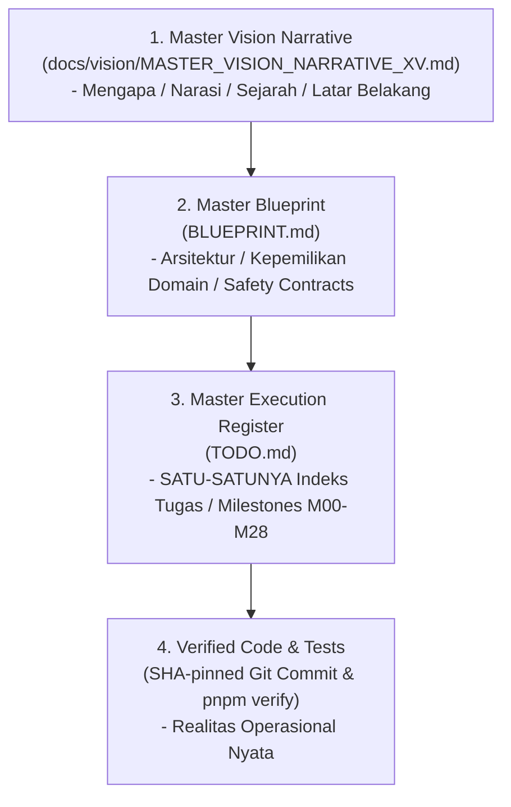

# M02-06 — Single Task, Status & Document Hierarchy Specification

- **Milestone**: M02 — XV Governance and Source of Truth
- **Status**: RATIFIED
- **Reference**: [BLUEPRINT.md §0, §1](file:///z:/project/moonradio/BLUEPRINT.md), [TODO.md](file:///z:/project/moonradio/TODO.md)

---

## 1. Hierarki Resmi Dokumen MoonWitness XV

Untuk mencegah kebingungan arah proyek, duplikasi daftar tugas, dan klaim fitur tanpa bukti uji, program MoonWitness XV menetapkan hierarki dokumen yang tegas:

---

## 2. Peran Masing-Masing Lapisan Dokumen

1. [**`MASTER_VISION_NARRATIVE_XV.md`**](file:///z:/project/moonradio/docs/vision/MASTER_VISION_NARRATIVE_XV.md)
   - **Peran**: Menjawab *mengapa* proyek ini ada, latar belakang filosofis, riset lintas repositori, dan narasi 99 bab.
   - **Batasan**: DILARANG memuat daftar todo teknis atau status checklist tugas.
2. [**`BLUEPRINT.md`**](file:///z:/project/moonradio/BLUEPRINT.md)
   - **Peran**: Kontrak arsitektur sistem, pembagian domain D00–D13, kontrak transisi ARSY Hub, dan batas keselamatan data.
   - **Batasan**: Menjelaskan *target arsitektur*, bukan bukti bahwa modul telah selesai dibuat.
3. [**`TODO.md`**](file:///z:/project/moonradio/TODO.md)
   - **Peran**: **SATU-SATUNYA SUMBER KEBENARAN STATUS KERJA**. Memuat 29 milestone (M00 s/d M28) dan 203 ID tugas unik dengan syarat bukti (*evidence gates*).
   - **Batasan**: Suatu tugas hanya boleh dicentang (`[x]`) jika telah lulus verifikasi pada SHA tertentu.
4. **Kode & Log Pengujian**:
   - Menjadi bukti final apa yang benar-benar berfungsi di runtime (`pnpm verify`).

---

## 3. Hasil Audit Duplikasi (*Anti-Duplication Audit*)
- **`README.md`**: Telah diselaraskan untuk merujuk langsung ke `TODO.md` sebagai register eksekusi tunggal. Tidak ada checklist independen di README.
- **`MASTER_VISION_NARRATIVE_XV.md`**: Mengakui `TODO.md` sebagai pemilik mutlak alur pelacakan implementasi.
- **`TODO.md`**: Memegang kontrol penuh atas pelacakan milestones M00 hingga M28.
