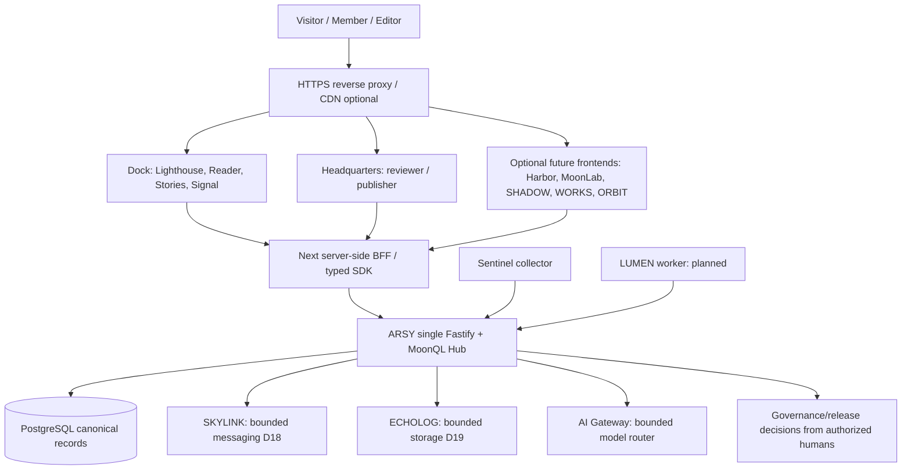

# A-L-L-A-H.COM — MASTER PRODUCT & TECHNICAL SPECIFICATION

**Edition:** Proposed Specification v1.0 · 29 October 2026 (WIB)  
**Program:** Empire of the Light / MoonWitness XV  
**Primary domain (proposed):** `a-l-l-a-h.com`  
**Single active implementation repository:** `https://github.com/bjo163/moonwitnessxv`  
**Source inspected:** branch `dev`, HEAD `cee2cdad3588be6c3432e3d92635c46e395b6432` (inspection during drafting).  
**Document status:** `DRAFT_FOR_OWNER_REVIEW` — normative *proposal*, **not** evidence of deployment or an accepted architecture decision.  
**Proposed repository location:** `docs/product/A-L-L-A-H-COM-MASTER-SPEC.md` (not committed by this document).  
**Authority order:** Accepted ADRs and live source code > `BLUEPRINT.md` for architecture > `TODO.md` for task/status > Vision narrative for identity and meaning > this proposed specification where not in conflict.

---

## 0. Executive specification

**A-L-L-A-H.COM** is a human-governed, cloud-hosted public gateway for the **Empire of the Light** vision: a connected ecosystem of trustworthy knowledge, contextual scripture research, media/storytelling, voluntary community participation, work, and responsible action. It is powered by the existing MoonWitness XV monorepo rather than a second platform or backend.

The name **A-L-L-A-H** is an intentional *project acronym*: **Accountable Life, Learning & Action Hub**. In the product UI, distinguish this project designation from **ALLAH**, the divine referent in Islamic belief. The brand cannot assert divine authority, exclusive truth adjudication by software, a new revelation, magical powers, or that cloud infrastructure is physically nearer to ALLAH.

**Origin story / editorial motif:** *From the Sky to the Cloud*. ROCKSOUL, a quiet person learning to be a “Manusia Pulpen,” reflects on the sky, starts a good intention on **Wednesday 28 October 2026**, and writes about it on **Thursday 29 October 2026**. The phrase “Mohon maaf, colong start ya ALLAH” is character dialogue expressing humility and urgency to start good work, **not** a theological doctrine. The narrative is a voluntary editorial feature; visitors should still access services and references without adopting its religious framing.

**North-star promise:** A visitor can discover an interesting claim or story, read its original/edition/source, distinguish *fact* from *interpretation*, explore related concepts, and optionally contribute or create useful work within explicit permissions and human review.

**First-release rule:** Launch a **truthful bilingual gateway on Dock**, preserve real Radio/Signal functionality, and show only evidence-backed features. Future application names may appear in an ecosystem atlas with clear **LIVE / DEMO / PLANNED** labels grounded in verifiable state. Do not imply that a planned service is already public or production-certified.

### 0.1 Outcomes

1. Make the Empire's mission and app map understandable within 30 seconds on the landing page.
2. Give public access to source-grounded reading/discovery and an approved story pilot.
3. Preserve MoonWitness XV's existing Radio/Signal experience; no regression.
4. Make the distinctions between science, source scripture, attributed interpretation, personal reflection, fiction, and AI-generated material explicit.
5. Give administrators one governed release workflow; no shadow publisher or second login authority.
6. Measure *verified benefit* (comprehension, source traceability, access, useful actions) rather than vanity counters or theological scores.

### 0.2 Non-goals

- No divine authority, religious verdict engine, salvation scoring, apocalyptic date predictions, or AI-issued revelations.
- No new ARSY-like backend, new independent auth system, second corpus database, or parallel public CMS created solely for this website.
- No launch-time requirement to deliver the full proposed Harbor, SHADOW, MoonLab, WORKS, HELIOGRID or entire 99-chapter universe.
- No speculative miracle economy, financial token, unlicensed artwork/music, unverified space claims, or claims that an imagined energy benefit is a measured result.
- No public exposure of Cockpit local process control, internal AI Gateway, raw SKYLINK messaging service, or unrestricted ECHOLOG storage.

---

## 1. Personas, access and jobs-to-be-done

| Persona | Access | Primary task | Permission boundary |
|---|---|---|---|
| Curious guest | Anonymous | Understand the mission; browse Stories, Radio, public Reader and verified references | Only approved public projections |
| Reader/researcher | Anonymous initially; voluntary account later | Inspect exact edition/citation; compare sources; see status and counterevidence | No unreviewed/private corpus or research data |
| Story audience | Anonymous | Follow visual comics, episode sequence, references and warnings | Published releases only |
| Member / contributor | Authenticated, opted-in (future Harbor) | Save library, contribute observations/projects, receive updates | Own private data; no implicit public consent |
| Creator/editor | Authorized | Prepare scenes, stories, artwork and evidence links | Draft/submit, **not** release approval |
| Researcher/reviewer | Authorized | Evaluate claims, conflicts, provenance and corrections | Source-scoped approvals, no unilateral bypass |
| Publisher / rights steward | Authorized and audited | Rights review, publication, withdrawal, correction | Four-eyes review for restricted/high-risk material |
| Operations / owner | Privileged | Health, backups, governance, cost and incident response | Headquarters only; least privilege, MFA |

**Community policy:** Public pages must be useful without requiring account registration, religious assent, membership, payment, or disclosure of sensitive beliefs.

---

## 2. Product experience architecture

### 2.1 Navigation — maximum six top-level public groups

| Top-level | Purpose | Proposed sections |
|---|---|---|
| **Home** | Meaning, promise, entry | Hero, manifesto, why A-L-L-A-H.COM, transparency, app directory |
| **Discover** | Navigate existing resources | Dock, public search, stations, schedule, topic hubs |
| **Knowledge** | Source-first understanding | Reader, Compare, UNILEX/Terms, Figures, Constellation, Timeline, Research |
| **Stories** | Editorial universe | MoonWitness XV, Manusia Pulpen, The Final Gathering, episodes, posters, archives |
| **Community** | Voluntary participation | Harbor (future), Journey/Patches, Impact/Charity (future) |
| **Ecosystem** | Apps and services | WORKS, MoonLab, SHADOW, ORBIT, HELIOGRID, app status and roadmap |

Persistent actions: language switcher (`id`/`en`), accessible search *only when functional*, account entry when available, help, source & rights, and privacy. Privileged Headquarters must not appear as a consumer action for anonymous users; the public directory may explain it abstractly.

### 2.2 URL map — first release on existing Dock

| Proposed canonical route | Content | Release priority | Notes |
|---|---|---|---|
| `/id`, `/en` | LIGHTHOUSE landing | P0 | Implement in `apps/dock`; `/` redirects deterministically |
| `/id/about`, `/en/about` | Mission, scope, creator's intent (clearly editorial) | P0 | Avoid religious-authority claims |
| `/id/ecosystem`, `/en/ecosystem` | Actual and proposed app map | P0 | Each item has evidenced status |
| `/id/stories`, `/en/stories` | Published stories index | P1 | Do not show unpublished originals |
| `/id/stories/manusia-pulpen`, `/en/stories/manusia-pulpen` | Serial narrative | P1 | Art/alt text, source distinction and versioning |
| `/id/stories/the-final-gathering`, `/en/stories/the-final-gathering` | 10-page poster series | P1 | Episode order, rights and scripture review required |
| `/id/reader`, `/en/reader` | Corpus Reader | P1 gated | Exists as Dock route; rights-approved sources only |
| `/id/reader/compare`, `/en/reader/compare` | Compare exact sources | P1 gated | Show edition, attribution and limits |
| `/id/terms`, `/en/terms` | UNILEX terms | P1 gated | One canonical lexicon owner |
| `/id/figures`, `/en/figures` | Figures / prophetic mission view | P1 gated | One Actor registry; no duplicate database |
| `/id/timeline`, `/en/timeline` | Timelines | P1/P2 | Differentiate historical / story chronology |
| `/id/research`, `/en/research` | Public reviewed research | P2 gated | **Must not expose raw private/unreviewed research** |
| `/id/stations`, `/en/stations` | Existing Radio | P0 preserve | Avoid breaking streams |
| `/id/schedule`, `/en/schedule` | Existing programming schedule | P0 preserve | Real schedule only |
| `/id/roadmap`, `/en/roadmap` | Scoped status, releases and plans | P0 | No fictional percentages |
| `/id/values`, `/en/values` | Core values, editorial ethics | P0 | Science vs interpretation explicit |
| `/id/privacy`, `/en/privacy` | Privacy and retention | P0 | Publish only real operating practices |
| `/id/sources`, `/en/sources` | Citation and rights policy | P0 | Plain-language reader guidance |
| `/id/contact`, `/en/contact` | Contact/support | P1 | Real delivery target and anti-abuse |

All names above are **proposed routes**, except the existing Dock route family checked in code; actual availability must be verified per release SHA. Do not implement duplicate handlers for an existing route when it can be composed using existing screen/data owners.

### 2.3 First-view design contract

- Hero eyebrow: `ACCOUNTABLE LIFE · LEARNING · ACTION`.
- H1: `A-L-L-A-H.COM`.
- Primary headline, ID: **“Dari menatap langit, menjadi tindakan yang bermanfaat di Bumi.”**
- Primary headline, EN: **“From wonder to knowledge. From knowledge to useful action.”**
- Supporting line: A human-governed place to discover sources, read stories, research responsibly, create and serve.
- Primary CTA: **Jelajahi / Explore** → functional public Dock sections.
- Secondary CTA: **Baca Cerita / Read the story** → published *Manusia Pulpen* only once editorially approved.
- Next modules: 4 discover cards (`READ`, `EXPLORE`, `CREATE`, `SIGNAL`), editorial feature, evidence & transparency, ecosystem status, impact/roadmap, footer.
- DO NOT render decorative fake search, invented user metrics, real-time badges without telemetry, hidden paywalls, or glorified imagery treated as scripture.

**Narrative sidebar (optional):** A dated author's reflection: Wednesday 28 October 2026 was the start of an intention; Thursday 29 October was when it was written down. The statement concerning light being created on Wednesday derives from a disputed narration (Sahih Muslim 2789), so attribute and label this as an interpretive inspiration, not a verified physical cosmological fact or a religiously privileged date.

---

## 3. Subdomain architecture — proposal, NOT current DNS inventory

The requested domain is **not verified as owned, configured, SSL-issued or live** in the repository evidence. No public URL below is confirmed active. The hosting proposal is independent of current local port names.

| Hostname | Product owner | Stage | Audience | Routing/operational rule |
|---|---|---|---|---|
| `a-l-l-a-h.com`, `www.a-l-l-a-h.com` | Dock/LIGHTHOUSE | P0 | Public | One canonical origin; HTTPS redirect from alias |
| `dock.a-l-l-a-h.com` | Dock | Optional later | Public | Alias/redirect if necessary, not duplicate SEO home |
| `moonwitness.a-l-l-a-h.com` | Dock/story experience | P2 | Public | Optional independent brand front, reuse same source/Story owner |
| `harbor.a-l-l-a-h.com` | Future Harbor | P2 | Voluntary members | Shared D00 sessions/identity; opt-in |
| `moonlab.a-l-l-a-h.com` | Future MoonLab | P2 | Researchers | Source-linked workbench; approval remains Headquarters |
| `shadow.a-l-l-a-h.com` | Future SHADOW | P2 | Authorized creators | Studio; no independent release authority |
| `works.a-l-l-a-h.com` | Future WORKS | P2 | Customers/providers | Real catalog/jobs/invoices; payment via licensed provider |
| `heliogrid.a-l-l-a-h.com` | Conditional HELIOGRID | P3 | Authorized operators | Deploy after measured read-only pilot; no miracle energy claims |
| `orbit.a-l-l-a-h.com` | ORBIT | P2 gated | Privileged | Authorized spatial frontend, 2D fallback; simulated fixtures clearly marked |
| `hq.a-l-l-a-h.com` | Headquarters/100CENTER | P1 gated | Privileged | MFA, RBAC, nonpublic data, network protection |
| `cockpit.a-l-l-a-h.com` | **Not approved** | N/A | **None** | Cockpit stays loopback/localhost only; do not publish this hostname |
| `api.a-l-l-a-h.com` | ARSY | P1 gated | Limited API clients | Expose only vetted routes; BFF preferred; no raw REST admin models |
| `skylink.a-l-l-a-h.com` | SKYLINK | Not public | Internal/provider webhooks | Provider-verified narrow webhook path only if required |
| `echolog.a-l-l-a-h.com` | ECHOLOG | Not public | Internal | Short-lived download grants; no public S3 API by default |
| `ai.a-l-l-a-h.com` | AI Gateway | Not public | Internal | Private model router and egress controls |
| `status.a-l-l-a-h.com` | Operations | Optional P2 | Public | Sanitized service-health notices only |

**Rule:** A subdomain is not necessarily a service. Prefer simple aliases/path routing in the first release. Avoid wildcard DNS and exposing privileged apps by default. For SSO across origins, define cookie scope/SameSite/CSRF strategy and threats before enabling; never use a domain-wide session cookie without a security review.

### 3.1 Local development registry (code evidence; NOT DNS)

`apps/arsy:3000`, `apps/dock:3001`, `apps/headquarters:3002`, `apps/aigateway:3003`, `tools/cockpit:3004`, `apps/skylink:3005`, `apps/echolog:3006`; Sentinel is a worker with no public port; LUMEN Runtime is a scaffold with `dev:false`. ORBIT is parked. **Single source of truth:** `scripts/apps.registry.mjs`.

---

## 4. Technical architecture and implementation ownership



**Design invariants:**

1. `apps/dock` is the first-release public experience and LIGHTHOUSE home; **do not** create a separate first-release `apps/lighthouse`.
2. `apps/arsy` is the **only** general-purpose Fastify/MoonQL Hub; preserve API prefix `/api/v1`, port 3000 local and source/role controls.
3. D00 Identity/Auth/Session remains canonical. Every frontend reads authorized projections through ARSY and typed contracts; no direct browser-to-PostgreSQL.
4. `apps/headquarters` / 100CENTER owns human publication and review; SHADOW drafts, MoonLab prepares research, but cannot self-approve.
5. `apps/skylink` owns bounded D18 messages/channel schema; no shadow copy of conversations in ARSY tables.
6. `apps/echolog` owns object bytes, hashes and grants; metadata/source-rights records stay with their canonical D01/D07/D08 owners; no `bytea` blob archive in PostgreSQL.
7. ORBIT only presents authorized task state; no separate DB, auth, agent executor or source-of-truth.
8. LUMEN future worker executes bounded approved steps behind ARSY contracts; AI Gateway only routes model calls. Neither decides religious truth or grants its own tool permissions.
9. Preserve existing Radio/Signal and DENPA capabilities with compatibility tests. Upgrades cannot erase program schedule, playlog, listening or station identifiers.
10. Historical repositories are import candidates only after explicit source/rights, attribution, canonical ID and rollback review. **Do not** split active implementation out of `bjo163/moonwitnessxv`.

### 4.1 UI stack

- Reuse `@moonwitness/moonui` as the single design system; React/Next.js already in Dock and Headquarters; use typed code consistent with XV monorepo.
- Grunge/moonpunk/neo-brutalist editorial flavor is a visual recipe only: semantic buttons, forms, contrast, keyboard support and accessible navigation remain consistent.
- Mandatory tokens, design states and reusable components; no inaccessible raster-only content. Poster imagery must have meaningful alt text/captions, with copy separately searchable.
- Avoid visual depictions of ALLAH or prophets. Religious source text must not be silently rewritten as poster design text.

### 4.2 Data model (logical; no new SQL owner implied)

| Domain | Canonical entity families | Reuse/owner |
|---|---|---|
| D00 | User, Session, Role, Permission, Audit | ARSY/MoonQL existing owner |
| D01 | Work, Edition, Passage, SourceArtifact, Citation, Translation, License | SOURCE/TEXT proposed canonical owner |
| D02/D03 | Term, Sense, Alias, Entity, ReviewedRelation | UNILEX/Ontology target owners |
| D04 | Figure, Role, Event, Timeline | Actor/Event target owner |
| D05 | ResearchCase, Claim, Evidence, CounterEvidence, ReviewOutcome | RESEARCH target owner |
| D06 | Consent, Testimony, Withdrawal, Revision | WITNESS target owner |
| D07 | Story, Arc, Episode, Scene, PosterAssetManifest, EditorialRevision | STORY + MEDIA target owner |
| D08 | RightsDecision, ReviewRequest, PublicationRelease, Retraction | Governance target owner |
| D09 | Station, Schedule, Playlog, Channel signal metadata | Existing SIGNAL owner |
| D10/D11 | ObservatoryRun, ExperimentalResult / Journey, Mission | Optional/future after ADR |
| D14–D17 | Membership, Commerce, Treasury, Energy assets | Proposed domains, **not accepted** |
| D18 | ChannelAccount, Conversation, Message, DeliveryAttempt | SKYLINK only |
| D19 | Object bytes, digest, object grants, lifecycle | ECHOLOG only; no SQL tables |

Every displayed item should carry `type`, `source_owner`, `visibility`, `rights_state`, `review_state`, `revision`, `timestamps` and optionally a citation/digest. Never conflate `STORY` with `EVIDENCE` or user testimony with an externally verified observation.

### 4.3 Minimum publication record

```json
{
  "slug": "manusia-pulpen-the-first-bug",
  "locale": "id",
  "content_kind": "EDITORIAL_STORY",
  "source_refs": ["quran:7:18", "quran:38:82-83"],
  "attribution": "MoonWitness XV editorial storytelling",
  "rights_state": "RIGHTS_EXACT_VERSION_CLEARED",
  "review_state": "APPROVED_WITHIN_SCOPE",
  "visibility": "PUBLIC",
  "published_revision": "reviewed-release-id",
  "asset_refs": ["echolog-object-reference"],
  "interpretation_disclaimer": true
}
```

This is an **illustrative logical payload, not an existing MoonQL model or production API response**. `published_revision` and asset refs are placeholders for actual versioned IDs, never fabricated in the live app. Fictional creative output and generated images cannot be labelled primary source testimony.

### 4.4 API behavior (requirements, NOT invented shipped endpoints)

- Reuse existing `/api/v1` and generated SDK/REST conventions; inspect route registry before adding endpoints.
- Public aggregation must return only allowlisted approved projections; anonymous `GET/list/expand/export/search` **must** be checked as rigorously as writes.
- Proposed conceptual capabilities: `browse published stories`, `read story release`, `lookup source edition`, `search approved corpus`, `get public ecosystem status`, `submit voluntary contribution` (future), `review/retract release` (HQ only).
- Response patterns: stable error envelope, idempotent writes where possible, pagination/cursors, request ID, version/ETag for cache safety, explicit `NOT_FOUND`, `RESTRICTED`, `SOURCE_UNAVAILABLE`, `WITHDRAWN`, `STALE` states.
- All mutations must be server-authorized, audited and scoped to real user permissions; UI route hiding is not authorization.
- Service-to-service auth uses secret manager, least privilege and rotation. Never expose model provider keys, ARSY admin tokens or media grants in browser JavaScript.

---

## 5. Trust and interpretation contract (non-negotiable)

### 5.1 Epistemic classification

Every piece of information is classified as one of:

- `PRIMARY_TEXT` (exact text/edition, source cited);
- `HISTORICAL_EVIDENCE` (time/place/document, explicit evidence and limits);
- `SCIENTIFIC_OBSERVATION` (measurement/source/method/unit/uncertainty);
- `ATTRIBUTED_BELIEF` (tradition, teacher or school identified);
- `PERSONAL_TESTIMONY` (self-reported, consented, not external verification);
- `INTERPRETATION` (argument, framing and alternatives);
- `FICTION / EDITORIAL_STORY` (creative treatment with source links);
- `AI_SUGGESTION` (unreviewed candidate, never automatic authority).

Do not allow user-facing filters to silently collapse these categories. The domain's religious name must not cause a visitor to think the product speaks for ALLAH or the Muslim community as a whole.

### 5.2 Scientific/religious cross-reference example

For *MoonWitness December 24 Code*, show separately:

1. Calculated astronomy, timezone (WIB UTC+7), ephemeris and reproducible parameters.
2. Verbatim source verses and translations with edition/rights and attribution.
3. Numeric clock-to-verse patterns as **post hoc symbolic associations**, not statistical proof.
4. Personal wisdom and practical action as an explicitly authored reflection.

Never claim 24 December 2026 as a proved Day of Judgment or the millennium's largest full moon without an independently verified quantitative criterion. Likewise, for narration about light being created on Wednesday (Sahih Muslim 2789), document scholarly disagreement rather than asserting a settled physical chronology.

### 5.3 Thematic guardrails

- **LOVE, MERCY, HUMILITY, ACCOUNTABILITY:** inspirational values, not permissions to pressure people.
- **Charity:** measurable disclosed outcomes; no spiritual reward guarantees, compulsory giving or fabricated impact.
- **Community:** voluntary participation, respectful interfaith dialogue, no claim that Christ's Mass literally means Al-Hashr.
- **Wisdom:** opt-in editorial module; practical kindness and responsibility, not superstition or fear-driven conversion.

---

## 6. Cloud, security, privacy and operational baseline

### 6.1 Environment topology

- `local`: node/pnpm workspace, isolated development data, loopback-only Cockpit.
- `preview`: protected ephemeral/staging deployment, sanitized fixtures, no production secrets or raw private stories.
- `production`: selected HTTPS public Dock gateway, ARSY API accessible only through a vetted edge/BFF pattern, locked-down Headquarters, separately protected storage and messages.
- DNS/TLS/domain registration are **deployment prerequisites to confirm**, not facts established by the project name.
- Avoid multi-cloud complexity until traffic/security evidence justifies it. Use minimal cloud resources and budget alerts, but never claim hosting is universally free.

### 6.2 Security gates (P0 before restricted public launch)

1. Default-deny authorization on all read/write/search/list/expand/export endpoints and per-record scope.
2. Eliminate unsafe implicit-public ACL assumptions; test MoonQL warning/require policy across every HTTP method, not just anonymous writes.
3. Headquarters route middleware must not rely on cookie *presence*; verify session validity and permissions server-side, with MFA for privileged accounts.
4. CSRF, XSS, SSRF, injection, open redirect, path traversal, rate limiting and request-size constraints in appropriate services.
5. Secret-scanning in CI; no keys or tokens in logs, screenshots, repo, build-time public env or telemetry.
6. Rights and privacy gate on all public source, image, clip, testimony, export, search and cache paths; withdrawal invalidates caches/search indices.
7. Separate privileged/admin origins and protect them with identity-aware proxy/VPN where appropriate.
8. No public network route to Cockpit. The local supervisor can start/stop processes and must remain loopback-only.
9. SKYLINK provider authenticity, replay/idempotency and sensitive message retention controls.
10. ECHOLOG signed/short-lived access, digest verification, legal hold, lifecycle and failed upload safety.
11. Database backup and **tested off-host restore**, migration rollback, deployment rollback and audit log retention.
12. Record actual production state with deployed commit/image SHA, health checks and dated proof.

**Benchmark:** security test plan follows the stable **OWASP ASVS 5.0.0** as applicable; this is a project testing target, not a statement of compliance.

### 6.3 Privacy and rights

- Data minimization; no mandatory birth date, religious identity or precise location for public browsing.
- Explicit consent for witness archives, user stories, portraits, user messages, newsletters and community publishing.
- Versioned terms/privacy with real retention/deletion workflows; user-visible withdrawal and correction.
- Religious texts: respect edition and translation licenses; source original and interface locale are separate.
- Story posters: provenance, image generation disclosure where relevant, asset alt text, editable article transcription and reviewed scriptural references.
- Charity/purchases: legal identity, applicable tax/invoicing/privacy obligations and licensed payment provider review before accepting funds.

### 6.4 Reliability targets (proposed acceptance budgets, not historical measurements)

| Measure | Initial target | Test |
|---|---|---|
| Public homepage availability | Target 99.5% monthly following launch stabilization | Uptime logs; error budget documented |
| Lighthouse first meaningful page | LCP ≤ 2.5 s at p75 mobile on chosen field data | Repeatable Web Vitals collection |
| Layout stability | CLS ≤ 0.1 at p75 | Field/browser tests |
| Interaction responsiveness | INP ≤ 200 ms at p75 where sufficient field data | Real-user performance monitoring |
| Reader citation integrity | 100% of visible passages identify source/edition or show explicit unavailable state | Dataset/API/browser contract suite |
| Locale parity | 100% critical landing/nav/legal keys in `id` and `en` | Automated i18n tests |
| WCAG target | 2.2 AA for critical public journeys | Automated + keyboard/screen reader audits |
| Data restore | Restore drill passes before first use of restricted data | Runbook evidence with timestamps and hashes |
| Sensitive data leakage | Zero known unrestricted private-model paths at release | Auth matrix + negative tests |
| Radio regression | Existing station/playback/schedule acceptance still passes | Cross-app contract tests |

Targets must be measured; they are not advertised as already attained.

### 6.5 Internationalization

- Respect accepted ADR-0005: canonical UI languages `id` and `en`; default fallback `en`; explicit supported URL locale wins over stored preference, account preference and Accept-Language.
- `id-ID` does **not** imply WIB or Indonesian citizenship; timezone and source-language are independent.
- `/id` and `/en` must both have accessible complete content, metadata, canonical URL and reciprocal hreflang; fallback on unavailable Hub keeps the truthful mission content available.
- Arabic original source text must render with proper RTL, script support and exact quotes from reviewed sources; translated UI labels never change source bytes.

---

## 7. Feature specifications, user flows and acceptance

### F01 — LIGHTHOUSE landing (P0)
**Given** an anonymous browser in a supported locale, **when** it opens `/id` or `/en`, **then** it sees the mission, product map, 4 real discovery cards, real status and links to sources/legal pages even if ARSY data calls fail. No account required. No fake search, fake counters, fake LIVE.

### F02 — App catalog / ecosystem map (P0)
Every app card contains `name`, `capability_summary`, `audience`, `implementation_state`, `public_access_state`, `destination` (only if verified), `owner`, `source_ref` and `last_reviewed_at`. **Implementation** and **deployment** statuses are separate. Proposed services never appear as live simply because a folder exists.

### F03 — Source Reader (P1 gated)
User can enter a real citation, select exact edition, see the source/version, view rights-aware text, discover related vetted content and copy a reproducible citation. Denied/missing content yields explicit states, never a guessed passage or an invisible substituted translation.

### F04 — Public Stories (P1 gated)
User can browse published releases, see episode sequence (e.g. Manusia Pulpen 01/04–04/04), navigate next/previous, open a readable transcript, read cited verses in attributed context and see a *fiction/interpretation* legend. Editors use SHADOW/HQ workflow; only HQ reviewer publishes. No unreviewed art or inferred usage rights.

### F05 — Discovery & Radio (P0 existing baseline)
Radio station catalog, real stream/player, schedule, genre/country and availability notices remain available; empty/offline states do not claim LIVE. No station identifier or API route regression.

### F06 — Research public results (P2 gated)
Research cases surface original source, claim, methodology, uncertainty, alternatives/counterevidence, decision status and updates. Only approved releases are exposed; raw SRGBL or hypothesis models are not automatically public.

### F07 — Harbor membership (P2 proposed)
Opt-in identity and profile under D00; save publicly available items, contribute a proposal with consent, edit or delete own contributions within retention/rights boundaries. No independent Harbor login database.

### F08 — Impact / charity (P2 proposed)
List real campaigns and measurable outcomes with responsible organization, verified receipts, legal disclosure, privacy, funding state and corrections. Payments/donations remain disabled until legal/provider/security review; volunteer-only pilot is allowed.

### F09 — WORKS economic services (P2 proposed)
Show real products/services and work offers; contracts, invoices and delivery history use verified identities and accepted accounting rules. Do not mix donation ledger and commercial invoice ledger. No stored card data unless an independently reviewed compliant provider flow permits it.

### F10 — HELIOGRID and Cosmos (P3 optional)
Differentiate observed/simulated/estimated energy data with units, device ID, time and calibration. Cosmos experiments need reproducible methods, source/timezone, observational uncertainty and a scientific-data label. No automatic spiritual interpretation from sensor data.

### F11 — HQ, ORBIT & agents (privileged future)
HQ owns approved actions; ORBIT visualizes simulated/real read models with explicit state labels and 2D fallback; any LUMEN run has approved tool allowlist, resource budget, checkpoint and review. AI-generated drafts cannot approve themselves.

---

## 8. Accessibility, design DNA and storytelling

### 8.1 Product look

- Moonpunk editorial / Gen-Z grunge / neo-brutalist **without** sacrificing readability. Dark ink/charcoal, paper texture, restrained gold/white, red hand-drawn corrective strokes; colors from MoonUI semantic tokens rather than duplicated arbitrary palettes.
- Use poster/serial visuals for editorial content, not as the only navigation or only presentation of scripture; accessibility and source accuracy take precedence over texture.
- ROCKSOUL's narrative depiction: typically male-coded red hoodie, back view/no recognizable face, pen/laptop, rain/moon/desk, a quiet character learning to write. This is a *creative character DNA*, not required product identity for every service.
- Avoid depictions of ALLAH and prophets; illustrate scripture through typography, landscape and metaphor with attribution.

### 8.2 Minimum components

Navigation (desktop/mobile), locale picker, universal link pattern, truthful status chip (no colored status theater), source/citation card, edition selector, readable verse block with Arabic RTL, research-evidence panel, poster episode navigator and transcript, accessibility settings, error/empty/loading panels, consent form, editorial review banner, changelog/corrections, footer/legal.

### 8.3 Content lifecycle

`DRAFT → SOURCE_CHECK → RIGHTS_CHECK → REVIEWED → RELEASE_APPROVED → PUBLISHED → CORRECTED / WITHDRAWN`

Only transitions allowed by real authorized roles; immutable release manifest retains source refs, asset digests, author/editor/reviewer, edition, date and correction chain. `RETRACTED` content must be removed or marked clearly per rights policy; do not keep a misleading cached copy publicly accessible.

---

## 9. Cloud deployment runbook contract (no deployment performed)

### 9.1 Preflight

- [ ] Verify domain registration/control, DNS zone and approved canonical origin.
- [ ] Verify `dev` SHA, dependency lockfile, clean build, tests, source-rights manifest, threat model and release scope.
- [ ] Confirm only approved apps exposed; Cockpit loopback remains enforced.
- [ ] Secure production PostgreSQL and required network boundaries; ARSY/HQ read/write scopes pass negative tests.
- [ ] Verify TLS, HSTS suitability, CSP, CSRF controls, secrets rotation and least-privilege deployment credentials.
- [ ] Configure CDN/cache policies that preserve privacy, retractions and correct Arabic assets.
- [ ] Stage real HTTPS `/id`, `/en`, Stories, Reader and Radio, plus `offline/denied` states.
- [ ] Record backup and off-host restore evidence; test release rollback and domain routing rollback.
- [ ] Record **deployed SHA/image digest**, approved change manifest and authorized human release sign-off.

### 9.2 Delivery pipeline

`dev commit → CI_VERIFIED → BUILD_VERIFIED → security/rights tests → DEPLOYMENT_READY → staged HTTPS/browser checks → DEPLOYED_VERIFIED → RELEASE_ACCEPTED → verified promote to main`.

Treat environment-specific deployment/promotions in the accepted release procedure; this sequence illustrates evidence categories and should not override the repository's exact approved release automation. **Never** claim deploy success from `pnpm verify` or the mere presence of Dockerfiles.

### 9.3 Failure states

- ARSY unreachable: the static mission + route map still render; dependent dynamic content says **temporarily unavailable**, not fabricated data.
- Radio offline: affected player shows real availability/stream error; other pages continue.
- Source rights missing: passage withheld with source ID, reason, and optional metadata only.
- Source withdrawn: purge public projections/index/cache and present correct withdrawal notice.
- Research unreviewed: not publicly returned.
- AI unavailable: original-source browsing remains functional.

---

## 10. Milestone plan — execution must be tracked in XV TODO.md, not duplicated here

This is a **specification-level dependency map**, not a second task-status register. Before creating any new unique task IDs, crosswalk against existing `TODO.md` M00–M41 and its existing G0–G7 groups.

| Stage | Sequence | Definition of done | Gate |
|---|---|---|---|
| **S0 — Baseline & decision** | Confirm repo HEAD, source owners, accepted ADRs, route map, DNS choices, design tokens, publication state | Signed owner/domain matrix, threat model, no duplicate app/owner | Before changes |
| **S1 — Lighthouse public MVP** | Dock bilingual landing, about, ecosystem map, privacy, sources, simple real links | `/id` and `/en` browser E2E + offline fallback + SEO/a11y | P0 |
| **S2 — Real utility** | Preserve Radio, source-rights-cleared Reader pilot, public Story episode and transcriptions | All source-rights gates, regressions, accessible scripts | P0/P1 |
| **S3 — Governance** | Public publication workflow, approved research release, retraction, HQ review | Rights & authorization matrix, audit, restore and rollback | P0 gate for sensitive data |
| **S4 — Community/Creation** | Harbor pilot; optional SHADOW and MoonLab extraction behind existing data owners | Opt-in, moderation, privacy and no parallel publisher | P2 |
| **S5 — Economy/Impact** | WORKS real-service pilot, charity governance / transparent outcome reporting | Legal/payment/accounting security & reconciliations | P2 |
| **S6 — Advanced** | ORBIT authorized feeds, LUMEN governed actions, HELIOGRID calibrated energy pilot | Real-vs-simulated, safety, budgets, 2D/a11y, recovery | P2/P3 |

### 10.1 Priority-first work packets

1. **Read current implementation:** Dock route tree, registry, README, ADRs and TODO exact SHA; list what truly works.
2. **Ratify hostname/SEO policy:** apex vs `www`, whether Dock and MoonWitness need separate hostnames, and HQ access model.
3. **Freeze hero/content taxonomy:** factual platform copy vs the author's devotional Manusia Pulpen story; make both id/en.
4. **Implement Lighthouse within Dock:** no new public app; preserve existing `/stations`, `/schedule`, `/reader` routes.
5. **Security gate:** audit anonymous read/list/search/expand/export permissions and HQ cookie/session verification; avoid sensitive data until cleared.
6. **Rights/publishing gate:** approved Story pilot, exact source verses/translation rights and approved poster assets.
7. **Verify real deployment:** browser checks, actual DNS/TLS, backups and deployment SHA evidence.
8. **Only then** create accepted future app surfaces after data owner and ADR review.

---

## 11. Risk register

| Risk | Severity | Mitigation/acceptance |
|---|---|---|
| Sacred-name confusion: software appears to claim divine authority | High | Visible project-acronym explanation; no AI divinity claims; reviewed editorial terminology |
| Multiple repos/apps duplicating ARSY, auth, data or publishing | High | One active XV repo, accepted D00–D19 owners, ADR approval before extraction |
| Public disclosure of unreviewed/private research and witness data | Critical | Default-deny GET/list/search/export, role/source tests, retraction gates |
| Mislabeling generated astronomy/verse patterns as prophecy | High | Classify science vs interpretation vs creative reflection; provenance + uncertainty |
| Copyright/translation/likeness violations | High | Exact-edition rights review, asset release manifests, attribution, takedown |
| Hostname sprawl, SSO cookie/CSRF exposure | High | Apex-first routing; selective domain rollout; least privilege/cookie model review |
| Unavailable Hub breaks homepage | Medium | Static mission shell + bounded optional dynamic data |
| Studio or Cockpit becomes public | Critical | Network isolation, origin checks, no public proxy, deployment scan |
| Charitable/commercial claims without ledgers or legal review | High | Do not accept funds prior to approved workflows; distinguish contributions from sales |
| Simulated ORBIT/energy values presented as real | High | Mandatory SIMULATED/UNKNOWN labels and verified observed-data provenance |

---

## 12. Release acceptance / sign-off matrix

### Product & editorial
- [ ] The site's purpose is understandable without religious or technical knowledge.
- [ ] The brand acronym and religious referent are carefully distinguished.
- [ ] Home, About, Ecosystem, Sources, Privacy and at least one real functional Discover destination are useful on `/id` and `/en`.
- [ ] The Manusia Pulpen dated origin is accurate as a *story* (28 October intent / 29 October narration), not misrepresented as externally validated religious history.
- [ ] Scripture/hadith references are source-checked; contested interpretations are attributed.
- [ ] All asset licenses, source edition rights, consent and alt text passed review.
- [ ] All visible app statuses are measured, dated and correctly limited.

### Engineering & operations
- [ ] All critical journeys pass keyboard/mobile and screen-reader review to WCAG 2.2 AA target.
- [ ] No unauthorized read/list/export/search of sensitive D00–D19 data.
- [ ] No public Cockpit/admin internals; HQ has real session validation.
- [ ] ARSY remains the only general-purpose Hub; SKYLINK/ECHOLOG contracts preserved.
- [ ] Radio station/schedule/player regressions pass.
- [ ] `/id`/`/en` SEO, canonical, hreflang and fallback behavior passes.
- [ ] Real HTTPS, DNS control, backup/restore, rollback and deployment SHA have evidence.
- [ ] An authorized human approves release at a verifiable source revision.

**Release result:** `NOT_ASSESSED` until checkboxes have actual recorded evidence, not self-attestation.

---

## 13. Recommended repository documentation boundaries

This document should be integrated as a **linked proposed product spec** in XV, not as a parallel source of truth. Upon owner approval:

- Add `docs/product/A-L-L-A-H-COM-MASTER-SPEC.md` and crosslink from `BLUEPRINT.md` / Vision only where appropriate.
- Add an ADR for **domain/canonical-hostname/security topology** if that decision is not already captured in accepted XV ADRs.
- Add a public website content and navigation contract if accepted; this spec's page routes are proposals until accepted.
- Amend `TODO.md` only after a **duplicate/dependency crosswalk**; it remains the sole execution-status and task-ID register.
- Never create a third branch; work directly on existing `dev` and promote validated changes to `main` according to repository gates.
- Do not claim this draft is committed or deployed unless a later tool action actually writes it to GitHub and records the result.

---

## 14. References / verification anchors

### Current user-owned primary implementation references

- MoonWitness XV source: https://github.com/bjo163/moonwitnessxv/tree/dev
- XV Blueprint: https://github.com/bjo163/moonwitnessxv/blob/dev/BLUEPRINT.md
- XV TODO: https://github.com/bjo163/moonwitnessxv/blob/dev/TODO.md
- XV Vision: https://github.com/bjo163/moonwitnessxv/blob/dev/docs/vision/MASTER_VISION_NARRATIVE_XV.md
- App/port registry: https://github.com/bjo163/moonwitnessxv/blob/dev/scripts/apps.registry.mjs
- Public sitemap source: https://github.com/bjo163/moonwitnessxv/blob/dev/apps/dock/src/app/sitemap.ts
- App runtime contract: https://github.com/bjo163/moonwitnessxv/blob/dev/docs/architecture/APPS.md
- Security contract: https://github.com/bjo163/moonwitnessxv/blob/dev/docs/architecture/SECURITY.md
- ADR-0001 ARSY: https://github.com/bjo163/moonwitnessxv/blob/dev/docs/decisions/ADR-0001-arsy-is-xv-hub.md
- ADR-0004 app boundaries: https://github.com/bjo163/moonwitnessxv/blob/dev/docs/decisions/ADR-0004-empire-surfaces.md
- ADR-0005 localization: https://github.com/bjo163/moonwitnessxv/blob/dev/docs/decisions/ADR-0005-locale.md
- Historical A-L-L-A-H reference repo (**not** new implementation home): https://github.com/bjo163/A-L-L-A-H/tree/dev

### External standards and implementation references

- OWASP ASVS stable 5.0.0: https://asvs.owasp.org/
- Next.js internationalization: https://nextjs.org/docs/app/guides/internationalization
- WCAG 2.2: https://www.w3.org/TR/WCAG22/
- Core Web Vitals: https://web.dev/articles/vitals

---

## 15. Final wisdom / brand manifesto

> **Aku menatap langit dan merenungkan kebesaran ALLAH.**  
> **Aku menatap Bumi dan melihat begitu banyak hal yang dapat diperbaiki.**  
> **Aku menatap tanganku dan memutuskan untuk mulai membangun.**
>
> *Cloud adalah tempat teknologi bekerja, bukan tempat untuk mengklaim kuasa ilahi.*  
> *Sebuah domain tidak menjamin kebaikan. Yang memberi arti adalah niat, kejujuran, dan perbuatan.*
>
> **BORN FROM LOVE. BUILT IN THE CLOUD. GUIDED BY FAITH. PROVEN THROUGH DEEDS.**  
> **ONLY YOU. YOUR DEEDS. AND ALLAH.**

**Specification end.**